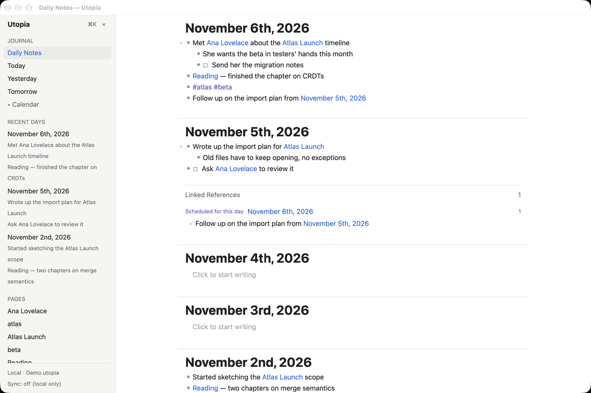
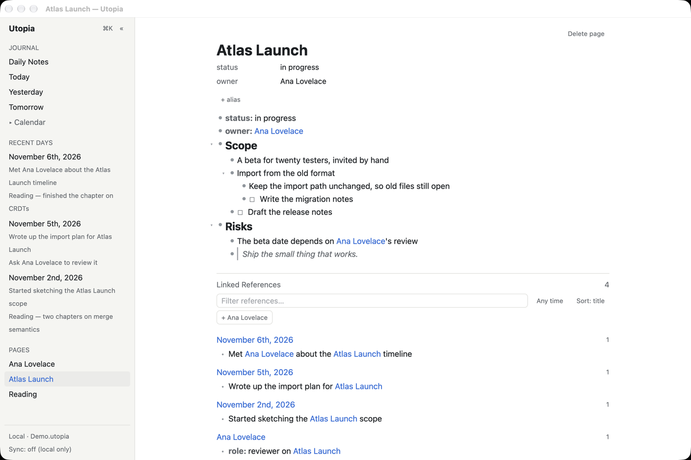
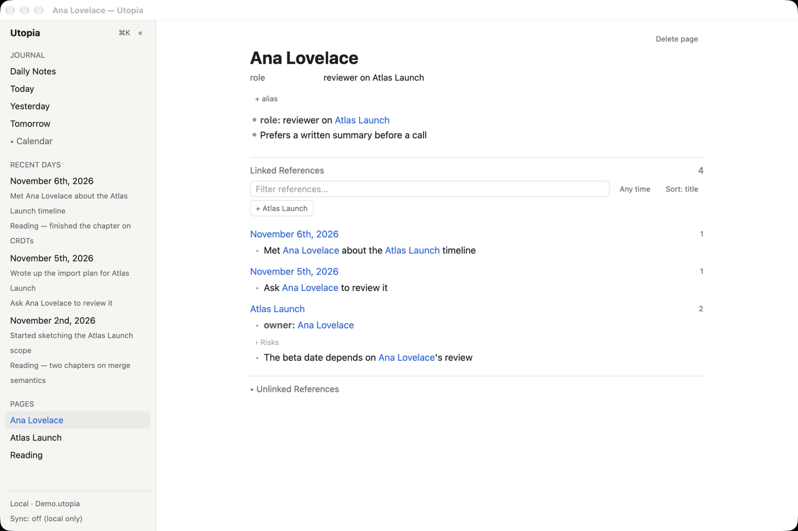
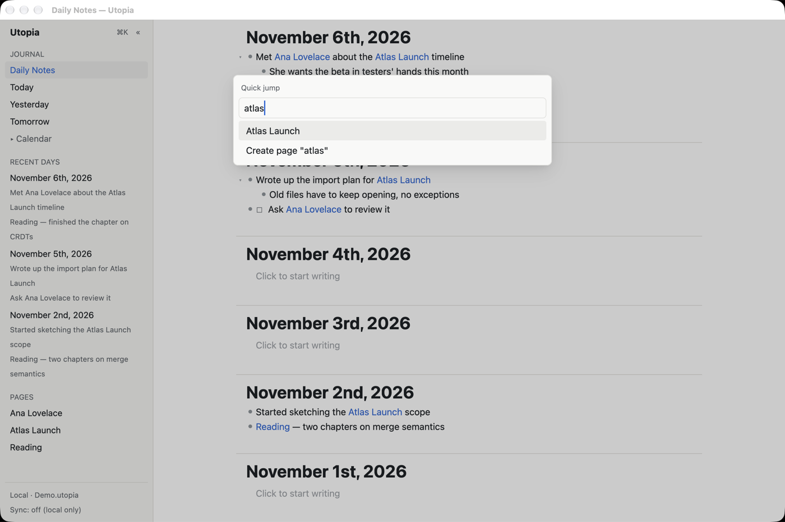
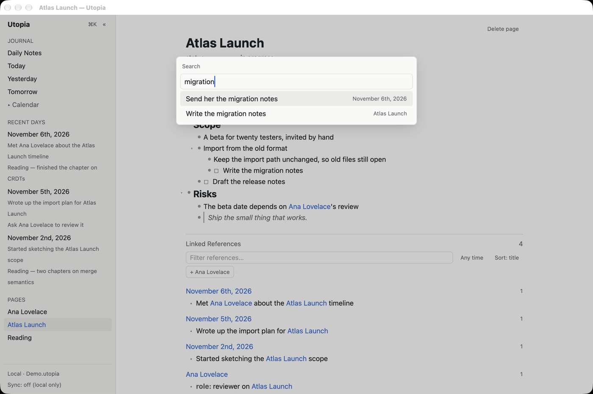
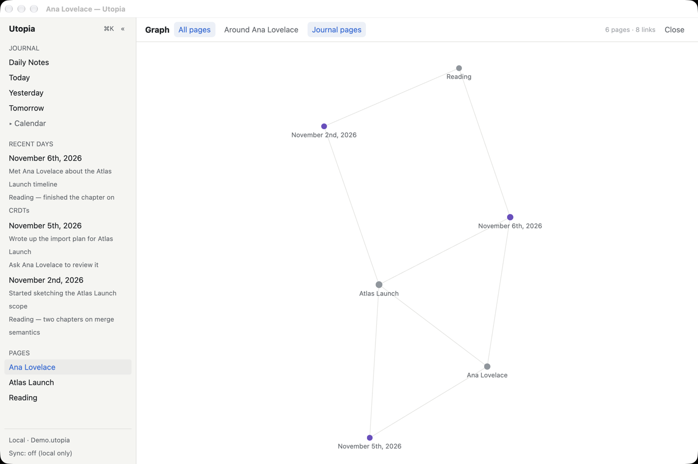
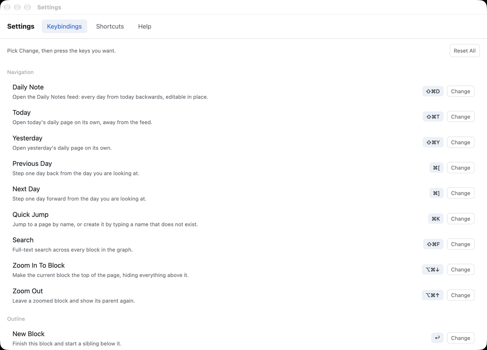

# Utopia

A local-first, Roam-style outliner for the desktop, written in Rust with a
[GPUI](https://www.gpui.rs) front end. Every bullet is a block you can link to, pages are
created the moment you type `[[Something]]`, and backlinks are computed for you. There are no
folders and nothing to file. Each graph is a single SQLite file on your disk, with
[Loro](https://loro.dev) CRDT documents underneath so that edits from several devices merge
without losing text. Sync is optional, and the relay is one you host yourself.

![Typing a [[link]] into today's note, then jumping to the linked page and finding the new block under Linked References](docs/images/demo.gif)

*Typing a `[[link]]` into today's note, then pressing Cmd+K to jump to that page: the new block
is already in its Linked References.*

## A short tour

**Daily Notes.** The app opens on a feed of every day from today backwards. Each day is
editable in place and shows its own Linked References. Relative dates such as `[[yesterday]]` or
`[[next sunday]]` become a link to that day when the block is committed.



**Outline, links and backlinks.** Blocks nest without limit. `[[Page]]`, `#tag` and
`#[[Multi Word]]` all create the same link. `key:: value` attributes appear in a header at
the top of the page. Under every page are its Linked References (with filters) and its
Unlinked References, where one click turns a mention into a link.





**Quick jump (Cmd+K).** Open a page by name, or create it by typing a name that doesn't
exist yet.



**Full-text search (Cmd+Shift+F).** Searches every block in the graph (SQLite FTS5).



**Graph view (Cmd+Shift+G).** A force-directed map of pages and links. It can show all
pages or only those around the current page, with journal pages toggled on or off.



**Settings → Keybindings (Cmd+,).** You can rebind any action by pressing the new keys, and
the change takes effect immediately. Settings also has a Shortcuts cheat sheet and a Help
tour.



Also implemented: to-dos, headings, quotes, code and numbered blocks; a slash menu; block
references, transclusion and embeds; the right sidebar (Shift-click a link) and split panes;
rename that merges duplicate pages and rewrites their links; journal and page templates;
quick capture (in-app and system-wide); query blocks; attachments and a PDF viewer with
highlights; undo/redo; Markdown, JSON and OPML export; Roam JSON import; optional encryption
at rest; sync through a self-hostable relay, a shared folder or the LAN, with end-to-end
encryption; a local HTTP automation API with `utopia://` links; and WASM plugins.
`AGENTS.md` → *Scope* has the full list.

## Build and run from source

You need:

- macOS. It is the only platform built and tested; CI runs on macOS 15.
- [rustup](https://rustup.rs) with a recent stable Rust (the workspace requires 1.85 or later).
- The Xcode Command Line Tools (`xcode-select --install`). The Metal toolchain is **not**
  needed, because GPUI compiles its shaders at runtime. Full Xcode is only needed for the
  iOS checks in `cargo run -p xtask -- mobile`.

```bash
git clone https://github.com/adityadaniel/utopia.git
cd utopia
source ~/.cargo/env
export DEVELOPER_DIR="$(xcode-select -p)"

make dev       # debug build on a throwaway graph in target/scratch (first build takes minutes)
make run       # debug build on your usual graph
make install   # release build of Utopia.app, ad-hoc signed, copied into /Applications
make check     # fmt, build, test, clippy: what CI runs
```

Run `make` with no target to list every task. A graph is one `.utopia` file. Utopia opens the
graph given by `--graph <file>` or `UTOPIA_GRAPH`. Without either, it reopens the last graph
you used, or the only one in `~/Documents/Utopia`, and otherwise asks you to name a new one.
Opening the installed app registers the `utopia://` URL scheme.

## Keyboard essentials

These are the defaults. Change any of them in Settings → Keybindings; Cmd+/ shows the full
list.

| Keys | Action |
|---|---|
| Cmd+Shift+D | Daily Notes feed |
| Cmd+Shift+T / Cmd+Shift+Y | Today / Yesterday |
| Cmd+[ / Cmd+] | Previous / next day |
| Cmd+K | Quick jump to a page (or create it) |
| Cmd+Shift+F | Full-text search |
| Enter / Shift+Enter | New block / line break inside the block |
| Tab / Shift+Tab | Indent / outdent |
| Cmd+Shift+Up / Down | Move the block, with its children |
| Cmd+. | Collapse or expand |
| Cmd+Alt+Down / Up | Zoom into a block / zoom out |
| Alt+Enter | Cycle to-do state |
| Cmd+Shift+C | Copy a `((block reference))` |
| Cmd+Z / Cmd+Shift+Z | Undo / redo |
| Cmd+\\ / Cmd+Shift+\\ | Toggle the left / right sidebar |
| Cmd+Shift+B | Toggle references under the page |
| Cmd+Shift+G | Graph view |
| Cmd+Shift+Space | Quick capture into today's note |
| Cmd+, | Settings |

## Project layout

The workspace is split into crates under `crates/`: `utopia-core` (domain), `utopia-doc`
(CRDT), `utopia-store` (SQLite), `utopia-sync` / `utopia-syncd` (sync client and relay),
`utopia-ui` (GPUI), `utopia-app` (the binary), plus `utopia-api`, `utopia-plugin` and
`utopia-ffi`. [`AGENTS.md`](AGENTS.md) explains the layout, the architecture rules,
headless commands such as `doctor`, `export` and `import-roam`, and how to drive the app
for screenshots. [`PRD.md`](PRD.md) is the spec.

## Status and limits

- Version 0.1.0. Desktop on macOS comes first. The PRD also targets Windows and Linux, but
  nothing is built or tested for them yet.
- Mobile: the Rust core builds for iOS, and the SwiftUI shell type-checks against the iOS SDK,
  but it has not been run on a device or a simulator. Android has generated Kotlin bindings
  and no app.
- `make app` / `make install` produce an ad-hoc signed bundle. It is not notarized.
- The PDF viewer needs macOS (PDFKit). Plugins run in an interpreter, so they are fine for
  commands but slow for heavy computation.
- The rest of the known limits are listed in `AGENTS.md` → *Known limits*.

## License

Apache-2.0, as declared in `Cargo.toml`.
