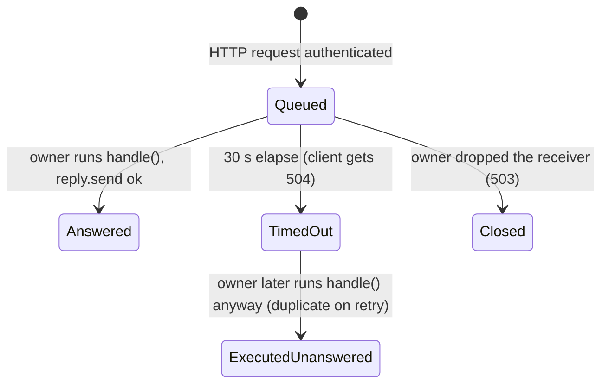

# Automation API call inbox: queued, answered, timed out but still executed

## What it controls

How an HTTP request to the loopback API (P2) becomes a store operation on the UI thread and
how the reply gets back. `crates/utopia-api/src/lib.rs`.

## Where the state lives

| Piece | Location | Notes |
|---|---|---|
| Queue | `api/lib.rs:450` unbounded `mpsc::channel()` of `ApiCall { op, reply: oneshot }` (`:346-349`) | drained by the owner via `try_recv`/`recv_timeout` (`:374-380`) |
| Per-request timeout | `:546` `tokio::time::timeout(30 s, rx)` | 504 at `:551` |
| Server lifecycle | `ApiServer { shutdown: Option<..>, thread: Option<..> }` (`:365-371`), consumed only in `Drop` (`:411-419`) | – |
| Auth | loopback/Origin/token checks `:511-536` | stateless |

## States

Per call: **Queued** → **Executed + answered** · **Queued** → **Client timed out (504)** →
**Executed anyway** (reply dropped).

## Events and transitions

- request → token check → `ApiCall` pushed → await `rx` up to 30 s.
- owner loop → `ApiCall::run` (`:353-361`): `handle(store, op)` unconditionally; `let _ =
  self.reply.send(..)`.

## Impossible or unhandled combinations (evidence)

1. **Timed-out calls still execute.** `run` never checks whether the receiver is alive and
   ignores the failed `send` (`:360`). A client that got 504 and retries `POST /v1/capture`
   produces a duplicate write; there is no age check or cancellation on the owner side.
2. **Unbounded queue**: a stalled UI thread accumulates calls without back-pressure (`:450`).
3. **"Graph is closed" has two meanings**: `503` before enqueue (`:544`) and `503` when the
   oneshot is dropped (`:550`).

## Diagram



## Would an explicit state type help?

A `deadline: Instant` on `ApiCall` and `if self.reply.is_closed() || Instant::now() >
self.deadline { return Vec::new() }` at the top of `run` would make TimedOut terminal.

```rust
enum CallState { Pending { deadline: Instant }, Done, Expired }
```
