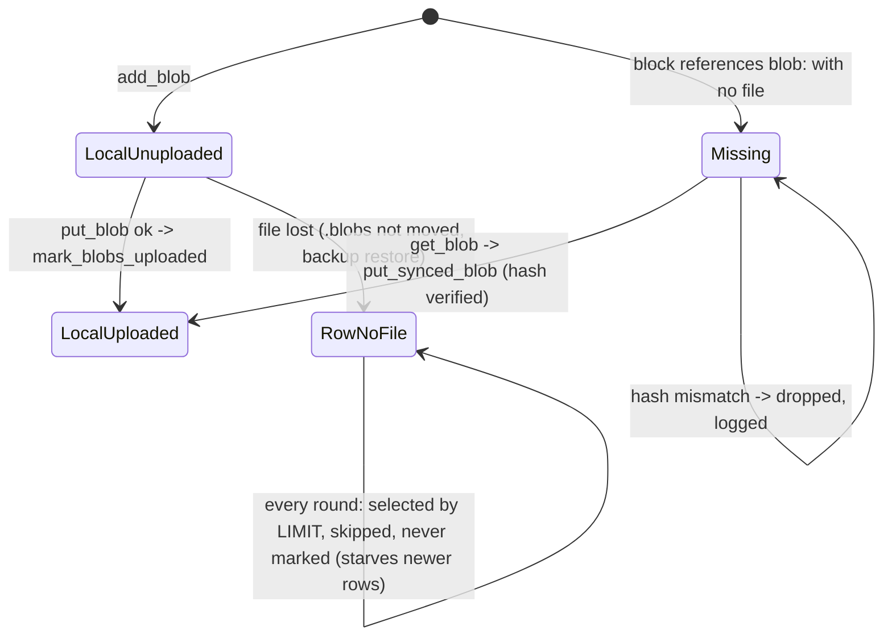

# Attachment blob state: row × file × uploaded × referenced

## What it controls

Whether an attachment (rule 12: content-addressed, verified) is on disk, has been uploaded,
is still referenced by a live block, and therefore what sync uploads or fetches each round.
`crates/utopia-store/src/attach.rs`, consumed by `crates/utopia-sync/src/lib.rs:324-338`.

## Where the state lives

| Piece | Location | Set | Cleared |
|---|---|---|---|
| Uploaded flag | `attachment.uploaded 0/1` (`schema.rs:178-186`) | `record` with `max(uploaded, excluded.uploaded)` (`attach.rs:111-119`); `mark_blobs_uploaded :240-248` | never |
| File present | `blob_path → exists()` (`attach.rs:46-52`) or `mem_blobs` (`lib.rs:124`, `attach.rs:92`) | `add_blob`, `put_synced_blob :177-185` (after hash check `:166-170`) | external deletion; `backup()` never copies blobs (`lib.rs:575-596`) |
| Referenced | `instr(text, 'blob:')` over live blocks (`attach.rs:189-201`) | block text | block text |
| To upload | `blobs_to_upload(limit)` (`:220-237`) | – | – |
| Missing | `missing_blobs()` (`:212-218`): referenced but no file; ignores the `attachment` table | – | – |

## States

**Local, unuploaded** (row, file, 0) · **Local, uploaded** (1) · **Missing** (referenced, no
file) · **Row without file** (file deleted, `.blobs` dir not moved with the graph, or a
restored `backup()` copy).

## Events and transitions

- drop/attach → `add_blob` → Local, unuploaded.
- sync round → `blobs_to_upload(BLOBS_PER_ROUND)` → `put_blob` → `mark_blobs_uploaded`.
- sync round → `missing_blobs()` truncated to 8 → `get_blob` → `put_synced_blob` (verified).

## Impossible or unhandled combinations (evidence)

1. **Upload starvation.** `blobs_to_upload` applies `LIMIT ?1` in SQL (`:223-225`,
   `ORDER BY created_at, hash`) *before* checking the file exists, then silently skips rows
   whose bytes are missing (`:232-236`) without marking them. If the oldest `limit` rows with
   `uploaded = 0` have no file, the function returns an empty list on every round and newer
   attachments never upload. Entry into that state: open a graph whose `.blobs` directory
   was not copied alongside, or restore a `backup()` file (`lib.rs:575-596` copies only the
   DB) somewhere without the old blob dir.
2. **Unuploaded but unreferenced** rows are uploaded anyway (`blobs_to_upload` ignores
   references; `missing_blobs` ignores the table). Harmless bandwidth.
3. **Row name/mime frozen.** `add_blob` on conflict updates only `uploaded` (`:115`), so a
   re-attached file keeps its first name forever. Documented behaviour, not drift.

## Diagram



## Would an explicit state type help?

A column, not an enum: `attachment.state ∈ {pending, uploaded, lost}` with `blobs_to_upload`
filtering `state = 'pending' AND file exists` and marking `lost` when the file is absent,
so the SQL `LIMIT` cannot pin the queue on dead rows.

```rust
enum BlobState { Pending, Uploaded, Lost { noticed_at: i64 } }
```
