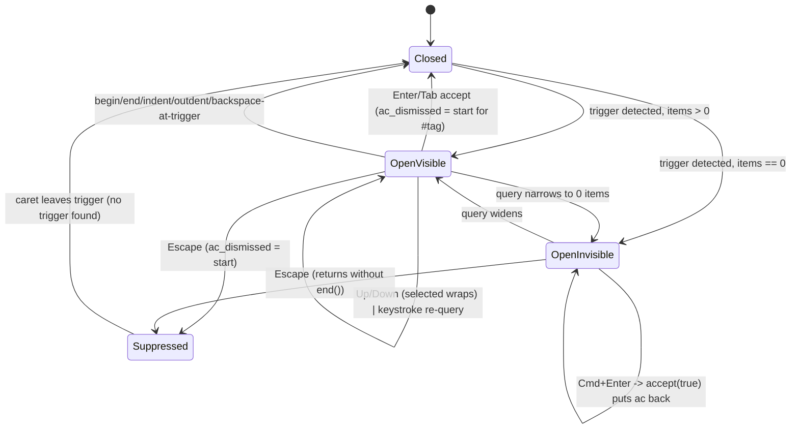

# Block editor autocomplete menu (`[[`, `#`, `((`, `/`)

## What it controls

Whether a completion menu is open, which trigger kind, its items and highlighted row, and
whether Enter / Tab / Up / Down / Escape / Cmd+Enter are captured by the menu instead of
acting on the block (`crates/utopia-ui/src/editor.rs`).

## Where the state lives

| Piece | Location | Set | Cleared |
|---|---|---|---|
| Menu | `editor.rs:216` `ac: Option<Autocomplete>`; struct at `:131-138` `{ kind, start, query, items, selected }` | `refresh_autocomplete` `:734-740` (`Some` whenever a trigger is detected, even with zero items); `accept` `:756` (put back) | `begin :307`, `end :323`, `sync_from_store :358`, `typed_bracket :509`, `refresh_autocomplete :653`, `accept :753/777/785`, `indent :931`, `outdent :936`, `backspace :943`, `escape :1222` |
| Suppressed trigger | `editor.rs:217` `ac_dismissed: Option<usize>` (byte offset of the trigger start) | `typed_bracket :510`, `accept :783`, `escape :1223` | `begin :308`, `refresh_autocomplete :654` (only when no trigger is found) |
| Highlight | `Autocomplete.selected` | `:733` (clamped), `vertical :1073-1077` (wraps) | – |
| Key context | `AUTOCOMPLETE_CONTEXT` at `:1397-1398`, applied when items non-empty | – | – |

Not read outside this file (grep for `.ac` in `page_view.rs`/`workspace.rs` is empty).

## States

- **Closed**: `ac = None`, `ac_dismissed = None`.
- **Open, visible**: `ac = Some`, `items` non-empty.
- **Open, invisible**: `ac = Some`, `items` empty — rendered as nothing
  (`render_autocomplete :1296-1298`), but *present* for some handlers.
- **Suppressed**: `ac = None`, `ac_dismissed = Some(start)`; the same trigger will not reopen.

## Events and transitions

- keystroke / `after_edit` → `refresh_autocomplete` (`:650-740`): detect trigger at caret;
  no trigger → `ac = None`, `ac_dismissed = None`; trigger at the dismissed offset → stay
  closed; else query the store and set `Some`.
- `Up`/`Down` → `vertical` (`:1071-1077`) when items non-empty.
- `Enter` → `newline` (`:890`) accepts when items non-empty; `Tab` → `accept_completion`
  (`:909`) same guard.
- `Cmd+Enter` → `insert_above` (`:917-919`) accepts when `ac.is_some()`.
- `Escape` → `escape` (`:1221-1227`): if `ac.is_some()` → dismiss and **return**; else `end()`.
- `accept` (`:745-790`): may create a page (`:760-772`), then replaces
  `ac.start..cursor + skip` with the completion using the **current** caret (`:773, :781`).
- `mouse_down` (`:1278`) calls `refresh_autocomplete` unconditionally.

## Impossible or unhandled combinations (evidence)

1. **Two definitions of "open".** Render, `newline`, `accept_completion`, `vertical` and the
   key context all use `is_some_and(|a| !a.items.is_empty())` (`:890, :909, :1071, :1296-1298,
   :1397`), but `escape` (`:1222`) and `insert_above` (`:917`) use bare `is_some()`.
   `refresh_autocomplete` yields `Some` with empty items for `#zzz` (the Tag kind gets no
   Create row, `:722`), `((zzz` with no hits, or `/xyz`. Path: type `/xyz`, press Escape →
   `:1222` takes `ac`, sets `ac_dismissed`, returns without `end()`; the user must press
   Escape twice to leave a block whose menu was never drawn. Cmd+Enter in the same state
   calls `accept(true)`, which puts `ac` back and returns (`:755-758`), silently swallowing
   `InsertAbove`.
2. **`ac.start`/`query` are frozen; `accept` uses the live caret.** Selection-moving actions
   (`select_left/right/up/down/select_all` `:1007-1024, :1094-1105`, `mouse_move` `:1282-1288`)
   only `cx.notify()`, never `refresh_autocomplete`. With `[[Alp|` open, Shift+Left moves
   `cursor()` to the selection start (`field.rs:55-61`), Enter → `newline :890` sees items →
   `accept` replaces `ac.start..8` instead of `..9`, leaving a stray `p` after the link.
3. **Menu can open during IME composition.** `after_edit` refuses to refresh while `marked`
   (`:516-518`), but `mouse_down :1278` does not check `marked`.
4. **`ac_dismissed` is a raw byte offset**, cleared only when *no* trigger exists (`:654`). If
   edits before the trigger shift a different trigger onto the same offset, it stays
   suppressed. No routine path found that hits this — uncertain, minor.

## Diagram



## Would an explicit state type help?

Yes. Make "no items" a distinct, non-capturing state so every handler asks one question.

```rust
enum Autocomplete {
    Closed,
    Suppressed { trigger_start: usize },
    Open { kind: AcKind, start: usize, query: String, items: Vec<AcItem>, selected: usize },
}
impl Autocomplete {
    fn captures_keys(&self) -> bool { matches!(self, Open { items, .. } if !items.is_empty()) }
}
```

`escape`/`insert_above` would then call `captures_keys()` like everyone else, and `accept`
could take the frozen `start..caret_at_refresh` range instead of the live caret.
