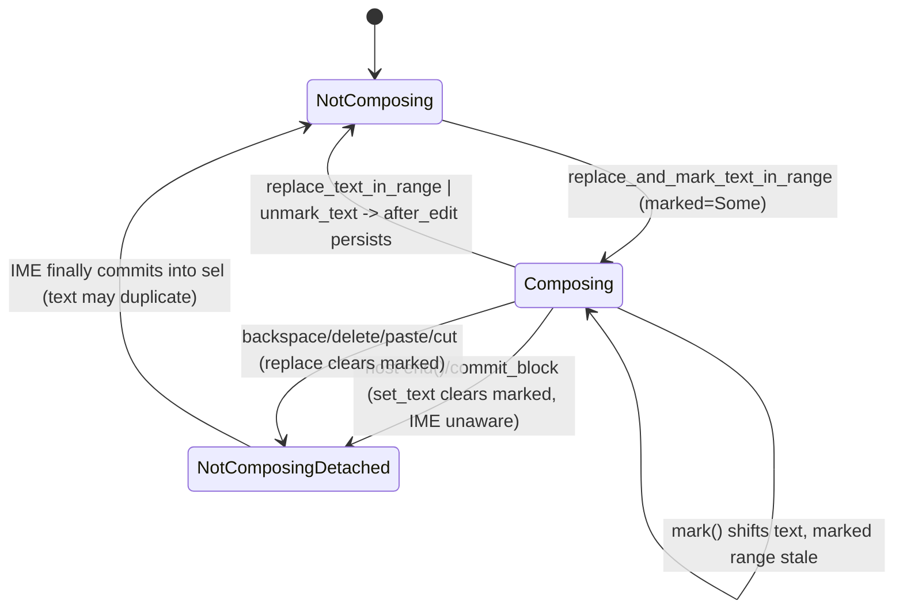

# Block editor IME composition: marked text vs committed text vs store

## What it controls

Whether the text in the field is provisional (an IME composition in progress, `§13.5`),
whether keystrokes persist to the store, and whether the store may overwrite the field.
Lives in `crates/utopia-ui/src/field.rs` (`TextField`) and is consumed by
`crates/utopia-ui/src/editor.rs` and `line_input.rs`.

## Where the state lives

| Piece | Location | Set | Cleared |
|---|---|---|---|
| Composition range | `field.rs:30` `marked: Option<Range<usize>>` | `replace_and_mark_text_in_range :358` | `set_text :52`, `replace :94`, `unmark_text :312` |
| Selection | `field.rs:28-29` `sel`, `reversed` | IME sets at `:379-380` | – |
| Store copy of the text | via `persist` (`editor.rs:524-558`) | every `after_edit` | – |
| Persist gate | `editor.rs:516-518` `after_edit` returns early while `marked` | – | – |
| Store→field gate | `editor.rs:332` `sync_from_store` returns early while `marked` | – | – |

Read outside: only through `EntityInputHandler` (`field.rs:308, 327, 353`) and editor render
(`editor.rs:1378`).

## States

- **Not composing**: `marked = None`; store text == field text after the last `persist`.
- **Composing**: `marked = Some`; field text contains provisional glyphs the store does not.

## Events and transitions

- `replace_and_mark_text_in_range` → Composing (no persist).
- `replace_text_in_range` / `unmark_text` → Not composing, then `after_edit` persists.
- `set_text` / `replace` → `marked = None` as a side effect (whoever calls them).

## Impossible or unhandled combinations (evidence)

1. **Host-driven commit mid-composition.** `commit_block` (`editor.rs:582-608`) has no
   `marked` guard, and `end()`/`commit()` are called by many host paths (clicks:
   `page_view.rs:363`; navigation: `workspace.rs:780, 942`; idle timer `editor.rs:547-556`).
   Path: composing, `marked = Some`; host calls `end()` → `expand_relative_dates`
   (`:614-648`) reads `self.field.text` *with* the provisional glyphs and may
   `set_block_text` them; then `before = field.text` (`:586`), the store's `commit_block`
   runs on the older persisted text, `after != before` → `self.field.set_text(&after, c)`
   (`:605`) wipes the composition and clears `marked` (`field.rs:52`) while the OS IME still
   thinks it is composing. Then `target = None`; the IME's eventual commit arrives via
   `replace_text_in_range` with `range_utf16 = None` → `.or(f.marked)` is `None` → falls to
   `f.sel` (`field.rs:327-328`) on a detached field. Whether macOS delivers Enter/Escape as
   gpui actions during composition is uncertain (the IME usually eats them); the mouse and
   timer paths are not gated by the IME at all.
2. **Action handlers clear `marked` silently.** `backspace :940-968` checks
   `marked.is_none()` for the pair-deletion branch (`:948-951`) — so the author expects
   Backspace during composition — yet `:965 self.field.replace(sel, "")` unconditionally
   clears `marked`, and `after_edit` persists. Same for `delete :976`, `soft_break :925`,
   `paste :1206`, `cut :1189`, `insert_text :438`. Afterwards `marked = None` on our side
   while the platform composition continues.
3. **`mark()` (`:1136-1144`, bold/italic/code) mutates `text`/`sel` directly** without
   clearing or shifting `marked`; `after_edit` then returns early (`:516`) so nothing
   persists, but `marked_text_range` (`field.rs:302-309`) reports a stale range to the IME.
   Reachability of Cmd+B during composition is uncertain.
4. **A remote/undo change arriving mid-composition is dropped** by the early return at
   `editor.rs:332`. If no later `Changed` arrives, the field stays stale until
   `commit_block` overwrites it (`:605`). Uncertain whether `app.changed` re-notifies.
5. **`LineInput` emits `Changed` only when not marked** (`line_input.rs:85-89`), and
   `set_text` (`:74-79`) never emits; a host mirroring `text()` can lag.

## Diagram



`NotComposingDetached` = our `marked` is `None` while the OS composition is still live; it
is the state the flags cannot name.

## Would an explicit state type help?

Yes. Composition should be a mode the editor is *in*, checked by `commit_block` and the
destructive actions, not a range someone may clear as a side effect.

```rust
enum Composition {
    None,
    Active { range: Range<usize>, snapshot_before: String },
}
impl BlockEditor {
    fn commit_block(&mut self, reason: CommitReason, cx: &mut Context<Self>) {
        if let Composition::Active { .. } = self.field.composition {
            // either refuse (defer the commit until unmark) or cancel the composition explicitly
            self.deferred_commit = Some(reason);
            return;
        }
        ...
    }
}
```

`field.replace`/`set_text` would take a `&mut Composition` by value transition rather than
silently resetting a field.
