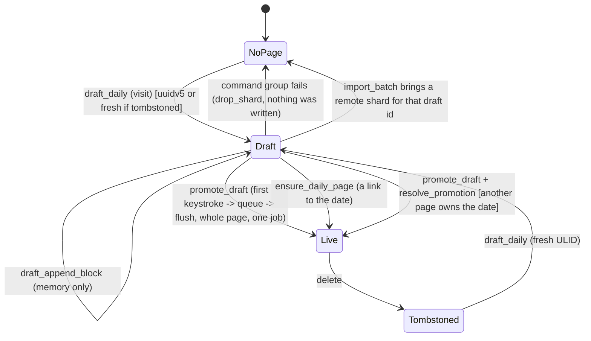

# Draft daily page: a day that is shown but not yet written

## Status

Updated by `fix/draft-daily-page`. The machine is explicit and all five issues below are
fixed (each fix has a failing-first test; see the commit list).

- **One value, one shard.** `Store.drafts` is `HashMap<PageId, DraftDay>`
  (`DraftDay { date, entry }`, `crates/utopia-store/src/lib.rs`) and the draft's Loro shard
  lives inside the entry, not in `docs`. `is_draft`, `draft_page(date)`, `days_between`,
  `load_doc` and `promote_draft` read that one value, so a draft whose shard is missing cannot
  be constructed. `promote_draft` (moves the shard into `docs`) is the only Draft → Live
  transition; promotion of the *identity* still happens in `queue`.
- **The doc's `DayPage { Live, Draft { id, doc } }` sketch** is what `DraftDay` implements,
  but it stays inside the store instead of becoming a public `Store::day(date) -> DayPage`.
  A day lookup returns a *different* id when a remote page owns the date, and the views that
  hold a `PageId` (editor, feed, sidebar) cannot follow a silently new one; `is_draft(&PageId)`
  and `draft_page(date)` are the two readers the callers actually need. `promote_draft` returns
  the draft's date so the store can resolve the collision itself (see 3).
- **The write guard the sketch asked for** is `resolve_promotion` in
  `crates/utopia-store/src/pages.rs`: before a promoted draft is committed, the index is asked
  whether another page already owns its date (a remote copy under a fresh id, rule 4). If so
  the draft's blocks move into that page (`plan_block_moves`, the same ids, so an open editor
  keeps its block) and the draft's shard is **dropped**, not written: a draft was never
  durable, and a `merged_into` tombstone for its id would let `reconcile_merged` drag the
  *still trashed* blocks of that id (the remote deleted it, rule 4) into the live day on every
  device (rule 5).
- **The discarded id stays a session alias.** `Store::redirect(&PageId)` maps it to the
  survivor; `load_doc`/`execute_multi` follow it (reads and writes keep working), `AppState`
  resolves it in `changed()` and emits `PageReplaced { from, to }`, and `BlockEditor` and
  `PageView` retarget themselves. `import_batch` drops the alias when a shard for the old id
  arrives, because the id is a page of its own again and identity logic must not act on the
  day instead. Undo steps are pointed at the survivor too (`execute_multi`), so undo commits.

Issues, as numbered below:

1. **Fixed** — a failed command group drops the draft *and* its shard (`Store::drop_shard`), so
   the day is simply unwritten again; `is_draft`, `page_state` and `draft_append_block` agree.
2. **Fixed** — `sync_index` clears `docs`/`pending` on a writer failure but no longer `drafts`:
   a draft has no durable state to reload, so the day the view is showing survives. This is
   about a *draft's* survival: a promotion job that itself fails still takes the typed text
   with it, because `sync_index` drops the promoted (no longer draft) shard — see the scope
   note below.
3. **Fixed** — `resolve_promotion` merges instead of colliding (`page_daily_uq`); the typed
   text lands on the date's page and the draft's id is never written. Visible change: a view
   or the editor holding the draft's id is retargeted to the page that owns the day.
4. **Fixed** — `id_taken` counts a shard only once it is queued or written (`claims_id`), and
   `create_page`/`ensure_daily_page` build the shard before inserting it (`install_new_page`),
   so the leak cannot happen either. The test (`fr_1_2_unwritten_shard_does_not_claim_its_id`)
   is a regression pin: it builds the pre-fix leak shape directly instead of making
   `SetPageMeta` fail, which it cannot be made to do through the public API.
5. **Fixed** — `start_note` reports whether it wrote (`StartedNote`) and `start_day` (and the
   same pattern in `focus_first`) only calls `AppState::changed` with `structural = true` for a
   real write; the three other visit paths (`open_journal`, `open_date`, `pick_date`) pass
   `false` because a visit never writes. No path forces a flush for a visit any more.

Nothing listed here is left open. **Not covered here** (other machines):

- a writer failure of the promotion job itself still loses the just-typed text, because
  `sync_index` drops the promoted shard and the text was never on disk. That is
  `store-commit-pipeline.md`'s repair path (the fix re-queues failed shards instead of
  dropping them), not this machine's; issue 2 above only keeps *un-promoted* drafts, which by
  construction hold no user text.
- what the editor/view should do for a page merged away by another mechanism (rename, §8.6);
  this machine only redirects the ids it discarded itself.

Tests: `crates/utopia-store/tests/acceptance.rs` (`fr_1_2_failed_command_leaves_no_ghost_draft`,
`fr_1_2_writer_failure_keeps_the_draft`, `fr_1_2_promoted_draft_merges_into_the_days_page`,
`fr_1_2_promoted_draft_does_not_resurrect_a_deleted_page`,
`fr_1_2_typing_after_a_merged_promotion_reaches_the_day`,
`fr_1_2_undo_after_a_merged_promotion_reaches_the_day`), `crates/utopia-store/src/pages.rs`
(`fr_1_2_unwritten_shard_does_not_claim_its_id`) and `crates/utopia-ui/tests/workspace.rs`
(`fr_1_2_starting_a_draft_does_not_flush_the_index`,
`fr_1_2_typing_survives_a_merged_promotion`, `fr_1_2_visiting_a_day_does_not_flush_the_index`).
Screenshots: `docs/verification/draft-daily-page/` — `feed.png` (the feed with mock data;
the day to click is folded), `day-started.png` (after clicking it: the day opened with the
caret in its empty block, RECENT DAYS unchanged, so the click wrote nothing) and
`day-written.png` (after the first keystroke: the day is a page and the sidebar lists it).

## What it controls

FR-1.2: a day becomes a page on its first write, not on a visit. Until then the day exists
only as an in-memory Loro doc held in `Store.drafts`; it is never projected, synced or seen
by `doctor`. The machine decides whether a `PageId` for a date is a draft, a live page, or
nothing, and when a draft is promoted or replaced. Identity is rule 4 territory (uuidv5 for
the date, fresh ULID if tombstoned).

## Where the state lives

The line numbers in this section and below are from the analysis snapshot (`main f5da7d1`);
the current locations are in **Status** above. In short: the draft map is
`Store.drafts: HashMap<PageId, DraftDay>` and the draft's shard is `DraftDay.entry`, not a
`docs` entry; `take_draft` is now `promote_draft` (write) and `discard_draft` (drop), and
`new_doc` is only used for pages whose shard is about to be written.

| Piece | Location | Set | Cleared |
|---|---|---|---|
| Draft map | `crates/utopia-store/src/lib.rs:121` `drafts: HashMap<NaiveDate, PageId>` | `draft_daily` `pages.rs:161` | `take_draft` `pages.rs:230-234` (from `queue` `lib.rs:357`, `import_batch` `pages.rs:743`); `ensure_daily_page` `pages.rs:91`; `sync_index` error `lib.rs:338` |
| In-memory doc | `lib.rs:110` `docs` entry for the draft id | `new_doc` `pages.rs:145` (`has_snapshot = false`, `persisted = ∅`, `lib.rs:520-521`) | command failure `pages.rs:157`; `execute_multi` failure `lib.rs:665`; `import_batch` `pages.rs:744` |
| Live row | `page` table via `live_daily` `pages.rs:21-31` | first commit | tombstone |
| View flag | `crates/utopia-ui/src/page_view.rs:240` `header.draft` | `:945` from `is_draft` | per rebuild |
| Feed inclusion | `days_between` `pages.rs:216-220` shows a draft only if `docs.contains_key` | – | – |

Readers: `is_draft` at `page_view.rs:945, 3819`; `draft_daily` at `page_view.rs:1287, 2048,
3498`, `workspace.rs:1292`; `draft_append_block` at `page_view.rs:3822`; `quick_jump.rs:470`.

## States

- **NoPage**: no row, no draft.
- **Draft**: `drafts[date] = id`, `docs[id]` exists, no `page` row, not in `pending`.
- **Live**: `page` row with `deleted_at IS NULL`.
- **Tombstoned**: row exists with `deleted_at`; `id_taken` true → the next draft/create for
  that date gets `PageId::fresh()` (`pages.rs:126-129`).

## Events and transitions

- visit date → `draft_daily` (`pages.rs:116-163`): `sync_index`; live page wins; existing
  draft with a doc wins; else build a doc from the journal template or one empty block and
  insert into `drafts`.
- click "start writing" → `draft_append_block` (`pages.rs:169-191`): in memory only.
- first keystroke → `execute_multi` → `queue` → `take_draft` true → `delta = None`,
  `promoted = true`, forces `flush` even in debounced mode (`lib.rs:356-381`). The whole
  page is written in one job.
- link to the date → `ensure_daily_page` (`pages.rs:81-111`): writes the draft out.
- remote copy arrives → `import_batch` drops the local draft (`pages.rs:741-745`).

## Impossible or unhandled combinations (evidence)

1. **`is_draft` disagrees with the other three readers.** `is_draft` (`pages.rs:225-227`)
   checks only `drafts`; `ensure_daily_page :87`, `draft_daily :122` and `days_between :217`
   also require `docs.contains_key`. `execute_multi` removes the doc on apply failure
   (`lib.rs:665`) without touching `drafts`. Then `page_view.rs:945` renders the header as a
   draft and `page_view.rs:3819-3822` calls `draft_append_block`, which goes
   `page_state → load_doc → NotFound` (`lib.rs:490-491`) because a draft has no `page_doc`
   row. Cleaned up only if `ensure_daily_page` later runs for that date (`pages.rs:91`).
2. **`sync_index` error clears `drafts` but the view keeps the id** (`lib.rs:336-338` vs
   `page_view.rs:240/945`). Same `NotFound` outcome; the draft's typed text was already
   promoted on the first keystroke, so only the empty block/template is lost (rule 5 holds
   for characters, not for the day's existence) — unless the *promotion job itself* fails,
   which the Status section lists as the pipeline's problem.
3. **Promoted draft can collide with a live page under a different id.** `dedupe_collisions`
   (`pages.rs:657-695`) runs only for imported pages present in the index; a draft has no
   row. If sync imports date D under a fresh ULID (the uuidv5 was tombstoned remotely, rule
   4) and the user then types into the still-open uuidv5 draft, `queue` promotes it and
   `project_page_row` inserts a second live row for `daily_date = D` → `page_daily_uq`
   (`schema.rs:28-29`) fails → writer error (see `store-commit-pipeline.md`). Usually the
   tombstoned uuidv5 shard arrives in the same batch and `take_draft :743` drops the draft
   first; batches are per round (`sync/lib.rs:355-365`), so co-arrival is not guaranteed.
   Uncertain frequency; rule 4 impact if it fires.
4. **`page_exists` counts leaked `new_doc` entries.** `create_page` (`pages.rs:64-73`) and
   `ensure_daily_page` (`:98-107`) do not remove the doc if `doc.apply` fails, unlike
   `draft_daily :155-159`. `id_taken` (`:34-41`) then reports the uuidv5 taken and the next
   create issues `PageId::fresh()` for a title that was never tombstoned (rule 4). Uncertain:
   `SetPageMeta` realistically does not fail; the asymmetry is real.
5. **`start_day` reports a structural change for a no-op write.** `page_view.rs:1292`
   `app.changed(Vec::new(), true, cx)` after `draft_append_block`, which queues nothing
   (`pages.rs:165-168`); this forces `flush_now` and an `IndexUpdated` cycle. Harmless, but
   "structural" no longer means "something was written".

## Diagram



`resolve_promotion` moves the draft's blocks into the page that owns the date; the draft's id
is dropped and kept only as a session alias (`Store::redirect`) that views and the editor
follow. The old `Ghost` states are gone: a draft cannot exist without its shard (`DraftDay`
owns it), and a writer failure no longer clears drafts (they have no durable state to disagree
with).

## Would an explicit state type help?

Yes. Make the draft a value the store owns and hands out, so "draft with no doc" cannot be
expressed.

```rust
enum DayPage {
    Live(PageId),
    Draft { id: PageId, doc: LoroPageDoc },     // doc lives inside the variant, not in `docs`
}
impl Store {
    fn day(&mut self, date: NaiveDate) -> Result<DayPage>;
    fn promote(&mut self, date: NaiveDate) -> Result<PageId>;  // the only way Draft -> Live
}
```

`is_draft` becomes `matches!(self.day_cache.get(&date), Some(DayPage::Draft { .. }))`, and
the collision in (3) can be checked in `promote` (`live_daily(date)` before writing).
