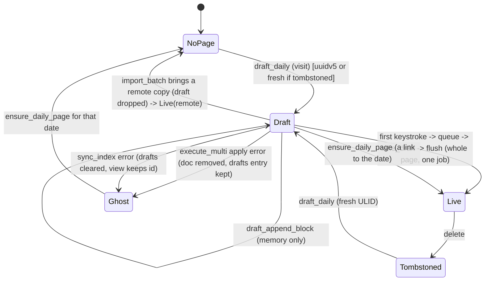

# Draft daily page: a day that is shown but not yet written

## What it controls

FR-1.2: a day becomes a page on its first write, not on a visit. Until then the day exists
only as an in-memory Loro doc held in `Store.drafts`; it is never projected, synced or seen
by `doctor`. The machine decides whether a `PageId` for a date is a draft, a live page, or
nothing, and when a draft is promoted or replaced. Identity is rule 4 territory (uuidv5 for
the date, fresh ULID if tombstoned).

## Where the state lives

| Piece | Location | Set | Cleared |
|---|---|---|---|
| Draft map | `crates/utopia-store/src/lib.rs:121` `drafts: HashMap<NaiveDate, PageId>` | `draft_daily` `pages.rs:161` | `take_draft` `pages.rs:230-234` (from `queue` `lib.rs:357`, `import_batch` `pages.rs:743`); `ensure_daily_page` `pages.rs:91`; `sync_index` error `lib.rs:338` |
| In-memory doc | `lib.rs:110` `docs` entry for the draft id | `new_doc` `pages.rs:145` (`has_snapshot = false`, `persisted = ∅`, `lib.rs:520-521`) | command failure `pages.rs:157`; `execute_multi` failure `lib.rs:665`; `import_batch` `pages.rs:744` |
| Live row | `page` table via `live_daily` `pages.rs:21-31` | first commit | tombstone |
| View flag | `crates/utopia-ui/src/page_view.rs:240` `header.draft` | `:945` from `is_draft` | per rebuild |
| Feed inclusion | `days_between` `pages.rs:216-220` shows a draft only if `docs.contains_key` | – | – |

Readers: `is_draft` at `page_view.rs:945, 3819`; `draft_daily` at `page_view.rs:1287, 2048,
3498`, `workspace.rs:1292`; `draft_append_block` at `page_view.rs:3822`; `quick_jump.rs:470`.

## States

- **NoPage**: no row, no draft.
- **Draft**: `drafts[date] = id`, `docs[id]` exists, no `page` row, not in `pending`.
- **Live**: `page` row with `deleted_at IS NULL`.
- **Tombstoned**: row exists with `deleted_at`; `id_taken` true → the next draft/create for
  that date gets `PageId::fresh()` (`pages.rs:126-129`).

## Events and transitions

- visit date → `draft_daily` (`pages.rs:116-163`): `sync_index`; live page wins; existing
  draft with a doc wins; else build a doc from the journal template or one empty block and
  insert into `drafts`.
- click "start writing" → `draft_append_block` (`pages.rs:169-191`): in memory only.
- first keystroke → `execute_multi` → `queue` → `take_draft` true → `delta = None`,
  `promoted = true`, forces `flush` even in debounced mode (`lib.rs:356-381`). The whole
  page is written in one job.
- link to the date → `ensure_daily_page` (`pages.rs:81-111`): writes the draft out.
- remote copy arrives → `import_batch` drops the local draft (`pages.rs:741-745`).

## Impossible or unhandled combinations (evidence)

1. **`is_draft` disagrees with the other three readers.** `is_draft` (`pages.rs:225-227`)
   checks only `drafts`; `ensure_daily_page :87`, `draft_daily :122` and `days_between :217`
   also require `docs.contains_key`. `execute_multi` removes the doc on apply failure
   (`lib.rs:665`) without touching `drafts`. Then `page_view.rs:945` renders the header as a
   draft and `page_view.rs:3819-3822` calls `draft_append_block`, which goes
   `page_state → load_doc → NotFound` (`lib.rs:490-491`) because a draft has no `page_doc`
   row. Cleaned up only if `ensure_daily_page` later runs for that date (`pages.rs:91`).
2. **`sync_index` error clears `drafts` but the view keeps the id** (`lib.rs:336-338` vs
   `page_view.rs:240/945`). Same `NotFound` outcome; the draft's typed text was already
   promoted on the first keystroke, so only the empty block/template is lost (rule 5 holds
   for characters, not for the day's existence).
3. **Promoted draft can collide with a live page under a different id.** `dedupe_collisions`
   (`pages.rs:657-695`) runs only for imported pages present in the index; a draft has no
   row. If sync imports date D under a fresh ULID (the uuidv5 was tombstoned remotely, rule
   4) and the user then types into the still-open uuidv5 draft, `queue` promotes it and
   `project_page_row` inserts a second live row for `daily_date = D` → `page_daily_uq`
   (`schema.rs:28-29`) fails → writer error (see `store-commit-pipeline.md`). Usually the
   tombstoned uuidv5 shard arrives in the same batch and `take_draft :743` drops the draft
   first; batches are per round (`sync/lib.rs:355-365`), so co-arrival is not guaranteed.
   Uncertain frequency; rule 4 impact if it fires.
4. **`page_exists` counts leaked `new_doc` entries.** `create_page` (`pages.rs:64-73`) and
   `ensure_daily_page` (`:98-107`) do not remove the doc if `doc.apply` fails, unlike
   `draft_daily :155-159`. `id_taken` (`:34-41`) then reports the uuidv5 taken and the next
   create issues `PageId::fresh()` for a title that was never tombstoned (rule 4). Uncertain:
   `SetPageMeta` realistically does not fail; the asymmetry is real.
5. **`start_day` reports a structural change for a no-op write.** `page_view.rs:1292`
   `app.changed(Vec::new(), true, cx)` after `draft_append_block`, which queues nothing
   (`pages.rs:165-168`); this forces `flush_now` and an `IndexUpdated` cycle. Harmless, but
   "structural" no longer means "something was written".

## Diagram



## Would an explicit state type help?

Yes. Make the draft a value the store owns and hands out, so "draft with no doc" cannot be
expressed.

```rust
enum DayPage {
    Live(PageId),
    Draft { id: PageId, doc: LoroPageDoc },     // doc lives inside the variant, not in `docs`
}
impl Store {
    fn day(&mut self, date: NaiveDate) -> Result<DayPage>;
    fn promote(&mut self, date: NaiveDate) -> Result<PageId>;  // the only way Draft -> Live
}
```

`is_draft` becomes `matches!(self.day_cache.get(&date), Some(DayPage::Draft { .. }))`, and
the collision in (3) can be checked in `promote` (`live_daily(date)` before writing).
