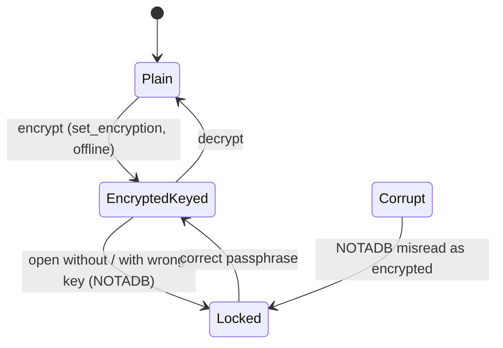

# Encryption at rest: key present / absent / wrong, and the schema version chain

## What it controls

Whether the two SQLite connections (read + writer) can open the graph file (SQLCipher on
macOS), what the app shows (unlock screen vs graph), and the one-way migration chain the
file has been through. `crates/utopia-store/src/crypt.rs`, `schema.rs`, `lib.rs`.

## Where the state lives

| Piece | Location | Notes |
|---|---|---|
| Key for the read conn | `lib.rs:148` `crypt::open_keyed(path, key)` | key is **not** stored on `Store` |
| Key for the writer conn | `writer.rs:238` `open_keyed(path, key)` | passed again by `open_with_key` (`lib.rs:150`) |
| Is-encrypted probe | `crypt.rs:26-34`, `:45-48` `is_encrypted` equates `SQLITE_NOTADB` with "encrypted" | – |
| Error | `StoreError::Encrypted` (`lib.rs:72-74`) | – |
| Schema version | `PRAGMA user_version` 0..7, `SCHEMA_VERSION = 7` (`schema.rs:11`); linear `if version < n` chain (`:231-281`) run on both connections (`lib.rs:160`, `writer.rs:240`) | `set_encryption` copies it manually into the re-keyed file (`crypt.rs:60, :68-69`) |
| App side | `RootState::Locked` (`crates/utopia-app/src/main.rs:165-180`); wrong passphrase → `lock()` again (`:308-311`) | – |

## States

**Plain** · **Encrypted + key** · **Encrypted, no/wrong key** (`StoreError::Encrypted`) ·
**Not a database** (reported as encrypted).

## Events and transitions

- open → `open_keyed`; `NOTADB` → `Encrypted` error → unlock screen.
- `encrypt`/`decrypt` CLI → `set_encryption` (`crypt.rs:50-77`): export to a new file, copy
  `user_version`, rename over the original.

## Impossible or unhandled combinations (evidence)

1. **A corrupt plain file reads as encrypted** (`crypt.rs:30-32, :45-48`), so the UI would
   prompt for a passphrase that cannot help. Uncertain whether callers distinguish.
2. **`set_encryption` assumes no open process** (doc at `crypt.rs:50-53`) but has no lock or
   check; running it while a `Store` holds two connections races the rename at `:75`.
3. **`backup()` is `VACUUM INTO`** (`lib.rs:581-582`) with no key handling; whether the copy of
   a SQLCipher DB carries the same key is SQLCipher behaviour not verified here — uncertain.
4. **No guard for `user_version > SCHEMA_VERSION`**: a file from a newer build opens silently
   in an older one (`schema.rs:231-281`). The last branch writes `SCHEMA_VERSION` rather than
   the literal (`:277`), so bumping the constant without adding a branch stamps the new
   number and skips the migration. Rule 14, not 1-5.

## Diagram

## Would an explicit state type help?

A tiny `enum FileKind { Plain, Encrypted, Corrupt }` from a header sniff (SQLite files start
with `SQLite format 3\0`; SQLCipher files do not) would separate (1) from a real lock, and
`Store` could carry `key: Option<Zeroizing<String>>` so the writer connection cannot be
spawned with a different key than the reader.
