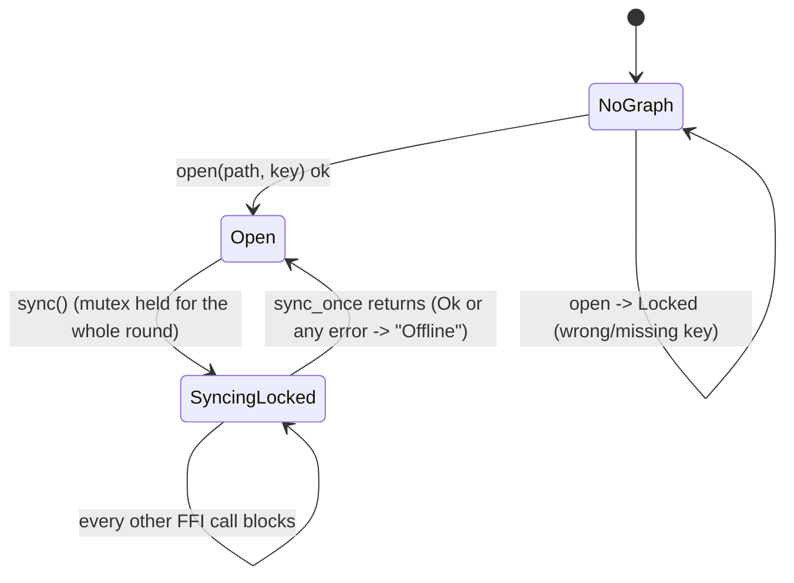

# FFI mobile core: graph handle, sync round under the store lock

## What it controls

The UniFFI surface for the mobile shell (`§14`): opening a graph, reading/writing blocks,
and running a sync round. `crates/utopia-ffi/src/lib.rs`, with the Swift side in
`mobile/ios/UtopiaMobile/GraphModel.swift`.

## Where the state lives

| Piece | Location | Notes |
|---|---|---|
| Graph | `ffi/lib.rs:83-85` `Graph { store: Mutex<Store> }` | no `Option<SyncEngine>`; a `SyncClient` is built per `sync()` call (`:290`) |
| Locked vs open | not a state: `Graph::open` either succeeds or returns `FfiError::Locked` (`:34, :124-129`) | – |
| Swift mirror | `GraphModel.swift:26-35, :88-111` `graph: Graph?`, `syncing: Bool`, `lastSync: String` | – |
| Error collapse | every `SyncError` → `FfiError::Sync { msg }` (`:276`) | Swift renders all as "Offline: …" (`swift:110`) |

## States

**No graph** → **Open** → **Syncing** (Swift flag; Rust: the lock is held).

## Events and transitions

- `open(path, key)` → Open or `Locked`.
- `sync(url, token, passphrase)` (`:286-298`): build transport, `self.with(|s| …
  client.sync_once(s) …)`. `with` holds `self.store.lock()` for the whole closure (`:88-93`).

## Impossible or unhandled combinations (evidence)

1. **The whole network round runs under the store mutex.** `sync_once` performs up to 6
   iterations of manifest/push/pull (`sync/lib.rs:396-410`) with 30 s HTTP timeouts
   (`http.rs:66`) while `with` holds the lock (`:88-93`, `:289-297`). Every other FFI call
   (`today`, `page`, `append_block`) blocks until it ends. The desktop deliberately avoids
   this (`sync_runner.rs:1-3`, `workspace.rs:528-532`).
2. **Two taps, two rounds.** Swift's `sync()` guards on `graph != nil` and a non-empty
   `relayURL`, not on `syncing` (`swift:89-90`), so a second tap queues a second full round
   behind the mutex.
3. **401 and protocol mismatch are indistinguishable from network loss** on mobile
   (`:276`, `swift:110`); PRD §12.6's "halt sync, prompt re-auth" cannot be represented.
4. **`pending_snapshots` die with the per-call client.** They are flushed within the call
   unless the 6-iteration cap is hit (`sync/lib.rs:396`), then lost until the manifest asks
   again (see `sync-compaction-snapshots.md`).

## Diagram



## Would an explicit state type help?

Yes: keep a `SyncEngine` on the `Graph`, split the round the way the desktop does
(`prepare` under the lock, `exchange` without it, `apply` under it), and expose the status
enum through FFI.

```rust
pub struct Graph { store: Mutex<Store>, engine: Mutex<Option<SyncEngine>> }
#[derive(uniffi::Enum)] pub enum SyncOutcome { Synced { at_ms: i64 }, Offline { queued: u32 }, NeedsAuth, Unsupported { version: u32 } }
```
