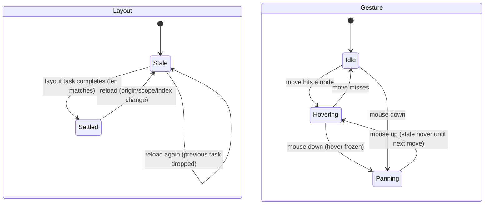

# Graph view: layout task, local/global scope, pan vs hover

## What it controls

The force-directed graph (`crates/utopia-ui/src/graph_view.rs`): whether positions are valid
for hit-testing, whether the view is the sidebar panel or full-screen, local vs global scope,
and the mouse gesture (pan vs hover).

## Where the state lives

| Piece | Location | Notes |
|---|---|---|
| Layout valid | `graph_view.rs:73` `laid_out: bool`; `:72` `pos: Vec`; `:84` `_layout: Option<Task>` | `reload :210-248` sets `laid_out = false`, keeps old `pos`, replaces the task; completion sets `pos` and `laid_out = true` guarded by `pos.len() == nodes.len()` (`:240`) |
| Scope | `:65` `local: bool`; `:67` `panel: bool`; `:64` `origin: Option<PageId>` | `local` initialised to `panel` (`:106-107`); `set_local(false)` only from the "All pages" chip (`:605`) |
| Gesture | `:76` `press: Option<(start, last)>`; `:77` `hover: Option<usize>`; `:79` `lit: Vec<bool>`; `:80` `hover_info` | `mouse_move :333-339` pans and returns before hit-testing while `press` is `Some` |
| Daily toggle | `:68` `include_daily` | – |

## States

Layout: **Stale** (`!laid_out`, old `pos` drawn? no — paint returns early at `:665`, `hit()`
returns `None` at `:283`) → **Settled**. Gesture: **Idle** / **Hovering(i)** / **Panning**.
Scope: `(panel, local)` with `(false, true)` unreachable.

## Events and transitions

- `reload` → Stale; task completion → Settled (dropping `_layout` cancels a stale task).
- mouse down → `press = Some`; move → pan (no hit test); up → `press = None` (`:340, :348-364`).
- "All pages" chip → `set_local(false)`.

## Impossible or unhandled combinations (evidence)

1. **`local` is a dead dimension of `panel`.** `local: panel` at `:106-107`; the only
   `set_local` caller passes `false` (`:605`) and only exists full-screen, where `local` is
   already false, so the chip toggles to the state it is in. `(panel = false, local = true)` is
   unreachable; `(panel = true, local = false)` is also unreachable.
2. **Hover freezes during a pan.** `mouse_move :333-339` returns before hit-testing while
   panning; `hover`, `lit`, `hover_info` and the tooltip are not recomputed on `mouse_up`
   (`:348-364`) until the next move. Cosmetic.
3. **`set_origin(None)` in a panel** reloads with `center: None` (`:212`), i.e. the whole
   graph under the "Around this page" header. Whether `main.page` can be `None` while the
   panel exists is uncertain (the observer at `workspace.rs:341-346` forwards whatever it is).

## Diagram

## Would an explicit state type help?

Small win: `enum Scope { Panel { origin: PageId }, Full { local: Option<PageId> } }` removes
the dead combination, and `enum Gesture { Idle, Hover(usize), Pan { start, last } }` makes
"clear hover on pan start, recompute on pan end" one transition.
