# Daily Notes feed: loading older days

## What it controls

How many calendar days the Daily Notes feed (FR-1.1) shows, when the next batch of older
days is requested, and when loading stops. Lives in `PageView` (`crates/utopia-ui/src/page_view.rs`).

## Where the state lives

| Piece | Location | Set | Cleared |
|---|---|---|---|
| Feed mode | `page_view.rs:337` `journal: Option<Journal>` | `open_journal :531-537` | `open :523` |
| Days requested | `page_view.rs:223` `Journal.limit: usize` (calendar days) | init `:532`; `+= JOURNAL_BATCH` at `:1276` | never shrinks |
| Batch in flight | `page_view.rs:225` `Journal.loading: bool` | `load_older_days :1274` | `rebuild_journal :1231` |
| Pages shown | `page_view.rs:224` `Journal.days: Vec<PageId>` | `:1230` | – |
| Sentinel row | `Item::JournalEnd` `:193`, pushed at `:1227` | every `rebuild_journal` | – |
| Trigger | `render_item(JournalEnd)` `:3563-3569` → `cx.defer(load_older_days)` | every frame the sentinel is laid out | – |

Read elsewhere: `journal_days`, `open_day_count`, `sticky_day` → `workspace.rs:1269-1281`;
tests at `tests/workspace.rs:599, 3151, 3183`.

## States

- **Not a feed** (`journal = None`).
- **Idle** (`loading = false`): sentinel rendered at the bottom.
- **Batch requested** (`loading = true`, `dirty = true`, `limit` already bumped).

There is **no terminal state**: nothing records "no older days exist".

## Events and transitions

- `open_journal` → Idle with `limit = JOURNAL_BATCH`.
- sentinel laid out (list renders a margin past the viewport) → `load_older_days`
  (`:1272-1281`): guard `!loading`; sets `loading`, bumps `limit`, dirties, notifies.
- `rebuild_journal` (`:1091-1234`): `days_between(from, today)` (`:1104`) where `from = today -
  (limit-1)`; loop at `:1114-1155` emits a `FeedDay` for **every** calendar day in the range
  (page or not); pushes `JournalEnd`; sets `loading = false`.

## Impossible or unhandled combinations (evidence)

1. **Unbounded growth.** Because `rebuild_journal` emits a row for every calendar day whether
   or not a page exists (`:1114-1155`), the sentinel is always `JOURNAL_BATCH` rows below the
   last request, and each frame in which it is within the list's render margin re-runs
   `load_older_days`. The only brake, `loading`, is cleared by the very rebuild the request
   caused (`:1231`). The result of `days_between` (`:1104`) is never inspected for "empty
   past this point". A user who scrolls to the bottom and keeps scrolling walks back through
   empty years, each batch costing a `days_between` query plus a per-day refs lookup
   (`:1138-1144`). `tests/workspace.rs:3182-3189` only scrolls until 26 pages appear, so the
   stop condition is untested because it does not exist.
2. **Two units for "how much is loaded".** `limit` counts calendar days; `days`/`journal_days()`
   (`:559`, used by `workspace.rs:1270`) counts pages. Callers reasoning about "N loaded"
   must know which.
3. **`loading` is meaningless outside `rebuild_journal`.** If `rebuild` takes the `page ==
   None` early return (`:919-922`) the flag stays `true`; only reachable in the transient
   state inside `open_journal` (`:538-539`) before `show` sets `page`. Not live.

## Diagram

```mermaid
stateDiagram-v2
    [*] --> NotFeed
    NotFeed --> Idle : open_journal (limit = BATCH)
    Idle --> Requested : JournalEnd laid out -> load_older_days (loading=true, limit += BATCH)
    Requested --> Idle : rebuild_journal (loading=false, sentinel re-pushed)
    Idle --> NotFeed : open(page)
    note right of Idle : no Exhausted state; the sentinel is always reachable
```



## Would an explicit state type help?

Yes: a small enum with an `Exhausted` arm, fed by a store query that reports the oldest
daily page (or by `days_between` returning nothing for the new window).

```rust
enum Feed {
    Idle { shown_through: NaiveDate },
    Loading { shown_through: NaiveDate, want_through: NaiveDate },
    Exhausted { shown_through: NaiveDate, oldest_page: Option<NaiveDate> },
}
// render JournalEnd only in Idle; in Exhausted render "No earlier notes" (§9.3 empty state)
```
