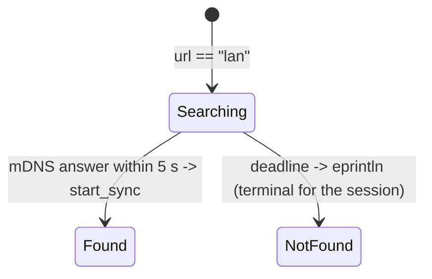

# LAN relay: serve/advertise and one-shot discovery

## What it controls

Hosting an in-process relay with mDNS advertisement (`UTOPIA_LAN_SERVE`), and discovering a
relay on the LAN when the sync URL is the string `lan`. `crates/utopia-syncd/src/lan.rs`,
`crates/utopia-app/src/main.rs:355-409`.

## Where the state lives

| Piece | Location | Notes |
|---|---|---|
| Relay alive | `app/main.rs:189` `_lan: Option<LanRelay>`; `lan.rs:18-22` `LanRelay { mdns: Option<ServiceDaemon>, _rt }` (`Option` encodes the advertise flag, `:53-68`; `Drop :24-30`) | – |
| Discovery task | `main.rs:383-405` `_discovery`; `discover` (`lan.rs:77-99`): deadline + `found: Option` + `break` on `Err` | one shot, 5 s |
| Mode sentinel | `SyncTarget::Relay { url == "lan" }` (`sync_runner.rs:49`, `main.rs:379`) | stringly typed |

## States

Serve: **Off** / **Serving** (advertised or not). Discover: **Searching** → **Found** (sync
started) / **NotFound** (logged, nothing else).

## Events and transitions

- `UTOPIA_LAN_SERVE` set → `serve_lan` → `start_sync` against `127.0.0.1:port` (`main.rs:359-371`).
- url `lan` → background `discover(graph, 5 s)` → `start_sync(url)` or `eprintln!` (`:391-404`).

## Impossible or unhandled combinations (evidence)

1. **Discovery runs once.** On `None` it only logs (`main.rs:403`); sync is silently never
   started for the session, with no retry and `SyncFacts` saying off. A relay that comes up a
   minute later is never found.
2. **`"lan"` is a magic string.** If any path handed it to `HttpTransport::new` the base URL
   would be `lan/v1/…`; guarded today only by the `if lan` branch (`:379-380`).

## Diagram

## Would an explicit state type help?

`enum SyncTarget { Relay { url }, Lan { graph }, Folder(PathBuf) }` removes the sentinel, and
`enum Discovery { Idle, Searching { until }, Found(String), Retrying { attempt, next } }`
gives the app a place to retry.
