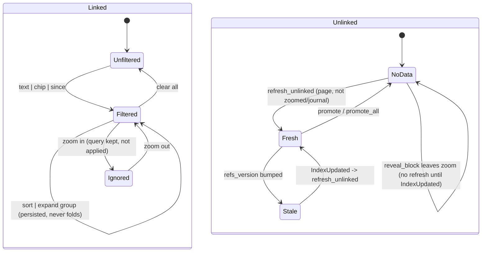

# Linked and unlinked references panel: filter, chips, sort, expansion, unlinked cache

## What it controls

The Linked References section under a page (`§7`): text filter, co-reference chips, date
filter, sort, "+N more" expansion, and the Unlinked References section with its one-click
Link. `crates/utopia-ui/src/page_view.rs`.

## Where the state lives

| Piece | Location | Set | Cleared |
|---|---|---|---|
| Query | `page_view.rs:301` `query: RefQuery { text, also, since, sort }` | `:461, :2993/:3029, :3223/:3232, :3230` | `show :603` |
| Filter input | `:330` `filter: Entity<LineInput>` (second copy of `query.text`) | subscription `:459-466` mirrors into `query.text` | `show :609` |
| Fetched refs | `:299` `refs: LinkedRefs`, `:300` `refs_key` | `:1016-1017` | see rebuild doc |
| Chip labels | `:304` `filter_titles: BTreeMap` | `:3030` | `:604` |
| Suggestions | `:303` | recomputed only with refs (`:1018`) | – |
| Expanded groups | `:305` `expanded_groups: HashSet<PageId>` | loaded `:610-619` from `local_get("refs_expanded:{page}")`, `set_expanded :1969-1982` | never (no fold) |
| Expanded children | `:307` `expanded_children` | `:407` | `:620` |
| Controls popover | `:327` `controls_menu: Option<ControlMenu>` | `:3094, :3120` | `:623, :3234` |
| Unlinked cache | `:333` `unlinked: Option<(u64, Vec<Mention>)>` | `refresh_unlinked :1083` | `:607, :2923, :2941` |
| Unlinked open | `:332` `unlinked_open: bool` | toggled `:3731` | never on page change |

## States

Linked: **unfiltered** / **filtered** (any of text, chips, since) × **sorted** × per-group
**folded/expanded** × controls **open/closed**.
Unlinked: **no data** (`None`, header shows no count `:1041-1049`) / **fresh**
(`version == refs_version`) / **stale** (version mismatch, treated as no data at `:1041`) ×
**open/closed**.

## Events and transitions

- Filter text (`:459-466`) → `query.text`, `refs_key = None`, dirty.
- Chip add/remove (`:2992-2997`, `:3028-3034`), date/sort pick (`:3221-3238`).
- "+N more" group (`:3685`) → `set_expanded` (persists in local_state).
- `refresh_unlinked` (`:1067-1086`): guarded on page `None`, zoom/journal, same version.
- Header click (`:3730-3734`) toggles `unlinked_open`; `promote :2914-2926`, `promote_all
  :2929-2944` link a mention and set `unlinked = None`, relying on `IndexUpdated` to refetch.

## Impossible or unhandled combinations (evidence)

1. **Zoomed view ignores the filter but keeps it.** `push_refs :1312` skips
   `Item::RefsControls` when zoomed; zoomed refs come from `block_backlinks :987` which never
   reads `query`. `query.text` typed before zooming stays set and silently has no effect
   until zoom-out.
2. **Unlinked count disappears after `reveal_block` leaves a zoom** (see `page-view-mode.md`
   item 1): `refresh_unlinked` is skipped while zoomed (`:1071-1074`) and `reveal_block` does
   not call it; the section renders with `count: None` and, if `unlinked_open`, with neither
   mentions nor "No unlinked mentions" (`:1050-1056`, `None => {}`).
3. **`unlinked_open` survives page changes** (not in the `:602-621` reset list). No evidence
   whether that is a sticky preference or an oversight.
4. **`expanded_groups` only grows** (`set_expanded :1969-1982` inserts; nothing removes) and
   is persisted per page, so a group once expanded can never be re-folded.
5. **Two copies of the filter text.** `show` resets both (`:603`, `:609`); whether
   `LineInput::set_text` emits `Changed` (which would re-dirty) is uncertain — harmless either
   way.
6. **Promote relies on an async refetch.** After `promote :2923` sets `unlinked = None`, the
   count returns only on `IndexUpdated`; if the writer ticket is not done
   (`app_state.rs:117-125`) the header shows no count meanwhile. Documented as intended at
   `:1036-1040`.

## Diagram



## Would an explicit state type help?

Modestly. The panel's state is mostly orthogonal preferences; the win is to tie the
unlinked cache to the view mode and to make "filter applies" explicit.

```rust
enum Unlinked { NotApplicable, Pending, Ready { version: u64, mentions: Vec<Mention> } }
struct RefsPanel { query: RefQuery, applies: bool /* false while zoomed */, unlinked: Unlinked, open: bool }
```

`set_mode` (see `page-view-mode.md`) would set `unlinked = Pending` whenever it leaves a
zoom, replacing the implicit "wait for `IndexUpdated`".
