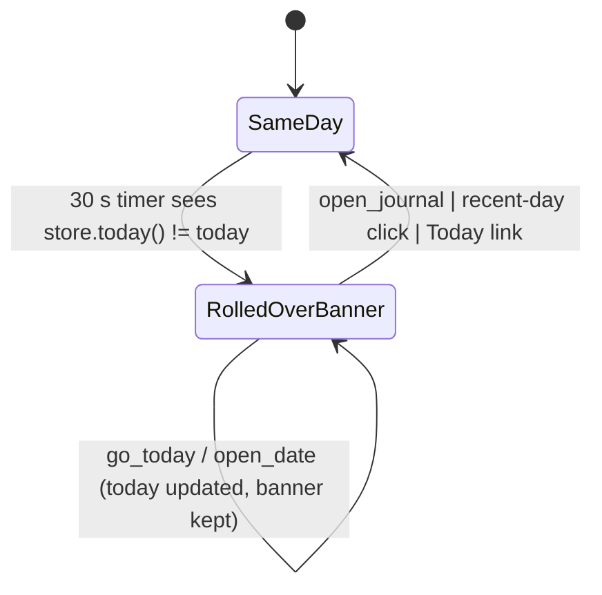

# New-day rollover: `today`, `new_day` banner, calendar month

## What it controls

Detecting that the calendar date changed while the app is open (FR-1.7), the "It's a new
day → open today" banner, and the month the sidebar calendar shows.
`crates/utopia-ui/src/workspace.rs`.

## Where the state lives

| Piece | Location | Set | Cleared |
|---|---|---|---|
| Today | `today: NaiveDate` | ctor `:325`; 30 s timer `:368`; `go_today :1227`; `go_yesterday :1235`; `open_journal :1245` | – |
| Banner | `new_day: bool` | timer `:370` only | `open_journal :1243`, recent-day row `:1810`, Today/Yesterday/Tomorrow links `:1836` |
| Calendar month | `month` | ctor `:325`, `shift_month :1498` | – |
| Sidebar cache | `sidebar_seen: Option<u64>` | `:371` forces a reload | – |

## States

**Same day** / **Rolled over, banner shown** (`new_day = true`) / **Rolled over, banner
dismissed**.

## Events and transitions

- Every 30 s (`:364-372`): if `store.today() != self.today` → set `today`, `new_day = true`,
  `sidebar_seen = None`, notify.
- `open_journal` → `new_day = false`, `today` refreshed.
- `go_today` / `go_yesterday` (`:1225-1238`) → `today` refreshed, `open_date(..)`; **`new_day`
  untouched**.

## Impossible or unhandled combinations (evidence)

1. **Banner stays after going to today.** `go_today :1225-1229` opens today's page without
   clearing `new_day`; so do `open_date :1283`, `pick_date :1487`, quick-jump `ChosenDay
   :890-892`, PrevDay/NextDay. The banner (`:2680-2693`) keeps inviting the user to open a day
   they are looking at until they click it or open the feed.
2. **`month` never follows the rollover** (only `shift_month :1498` writes it). After
   midnight on the last day of a month the calendar strip shows the old month with no
   "today" cell.

## Diagram



## Would an explicit state type help?

A single `Day { date, banner: bool }` updated through one `set_today(date, reason)` would
do; or derive the banner as `shown_day != today` and drop the flag entirely:

```rust
struct DayClock { today: NaiveDate, month: NaiveDate, acknowledged: NaiveDate }
fn banner(&self) -> bool { self.acknowledged < self.today }   // any open_date(today) sets acknowledged = today
```
