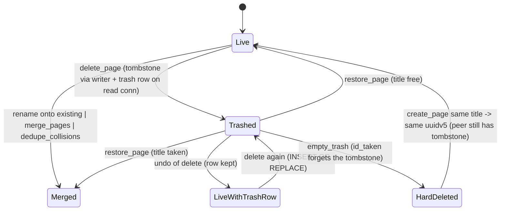

# Page lifecycle: live, trashed, merged, hard-deleted

## What it controls

Title/date uniqueness, what Delete/Restore/Empty Trash do, when a page id may be reused
(rule 4: "if the computed uuidv5 is tombstoned, issue a fresh ULID — never resurrect"), and
rename-onto-existing merges (rule 8). `crates/utopia-store/src/pages.rs`.

## Where the state lives

| Piece | Location | Set | Cleared |
|---|---|---|---|
| Tombstone (CRDT) | `PageMeta.deleted_at: Option<i64>` (`crates/utopia-core/src/command.rs:83-86`) | `delete_page :476-483`, `plan_merge :449-453` | `restore_page :510-518` |
| Merge pointer (CRDT) | `PageMeta.merged_into: Option<PageId>` | `plan_merge :449-453` | `restore_page :510-518` |
| Trash row (SQLite, read conn) | `trash` table | `delete_page :485-488` (`INSERT OR REPLACE`) | `restore_page :522-523`, `empty_trash :558` |
| Projection | `page.deleted_at` column (`project.rs:321-338`); `PageKeys.live` flip (`project.rs:63, :246`) | writer | writer |
| Shard existence | `page_doc` row; `page_exists` (`lib.rs:468-478`) also true for any loaded doc | first commit | `empty_trash :557` (FK cascade) |
| Id reuse guard | `id_taken` (`pages.rs:34-41`) = `page_exists || EXISTS(page row)` | – | – |

Readers: `header.deleted` at `page_view.rs:943`; `page_exists` at `sync/lib.rs:380`.

## States

**Live** (`deleted_at = None`) · **Trashed** (`deleted_at = Some`, `merged_into = None`,
trash row) · **Merged** (`deleted_at = Some`, `merged_into = Some`, no trash row) ·
**HardDeleted** (no rows, no shard).

## Events and transitions

- `delete_page` (`:466-490`): refuses an already-tombstoned page (`:470-472`); tombstone via
  `execute` (meta change → immediate flush, `lib.rs:686-688`); trash row on the read conn.
- `restore_page` (`:493-525`): early return for a live page (`:497-499`); if the title/date is
  taken → merge instead (`:504-508`); else clear both fields, delete the trash row.
- `merge_pages` / `rename_page` / `dedupe_collisions` → Merged in one transaction and one
  undo group (`:449-453`, rule 8).
- `empty_trash` (`:542-565`): deletes `ref`, `block`, `page_update`, `page` (cascades
  `page_doc`, `alias`), `trash`; evicts `docs`.
- `reconcile_merged` (`:704-733`): re-homes orphans when both fields are `Some`.

## Impossible or unhandled combinations (evidence)

1. **Trash row with a live page after undo.** The trash row is written outside the undo group
   (`:485-488`); Cmd+Z re-applies the inverse `SetPageMeta` (`lib.rs:775-797`) and leaves the
   row. `list_trash` hides it by joining on `deleted_at IS NOT NULL` (`:530-533`), and
   `restore_page` returns before `DELETE FROM trash` for a live page (`:497-499` vs
   `:522-523`), so the row persists until the next delete's `INSERT OR REPLACE`. Harmless,
   un-modelled.
2. **Tombstone and trash row are two transactions.** The tombstone goes through the writer;
   the trash row is autocommitted on the read connection (`:485`). If the writer job fails
   (see `store-commit-pipeline.md`), the page is live with a trash row — same hidden state
   as (1). Rule 2 in spirit (a projection-adjacent row out of step with the shard).
3. **Empty Trash erases the memory rule 4 depends on.** After `empty_trash`, both legs of
   `id_taken` are gone (`:557` deletes the `page` row; `page_doc` cascades; `docs` evicted
   `:561-563`), so `create_page("Foo")` yields `PageId::for_title_key` again (`:59-62`). A
   peer that still holds the tombstoned uuidv5 shard will `doc.import` the new page's ops
   into that tombstoned doc on sync (`import_batch :746-747`), and the local copy receives
   `deleted_at` back. Whether this is intended ("hard delete exists only for empty-trash",
   rule 5) is uncertain; the guard has no memory beyond the `page` row.
4. **`empty_trash` does not clear `drafts`, outbox or `sync_state`** for the page
   (`:550-563`), unlike `sync_index`'s three-way clear (`lib.rs:336-338`). Outbox retention
   is by design; the asymmetry is noted.

## Diagram



## Would an explicit state type help?

The CRDT side is already explicit enough (`deleted_at`/`merged_into`); the gap is the local
bookkeeping. A `tombstone_memory` table (id, deleted_at) that `empty_trash` keeps, consulted
by `id_taken`, would restore rule 4's memory; and writing the trash row inside the same
writer job (a `PageJob.trash: Option<TrashRow>`) would remove states (1) and (2).

```rust
enum PageFate { Live, Trashed { at: i64 }, Merged { into: PageId, at: i64 }, Purged { was: PageId, at: i64 } }
```
