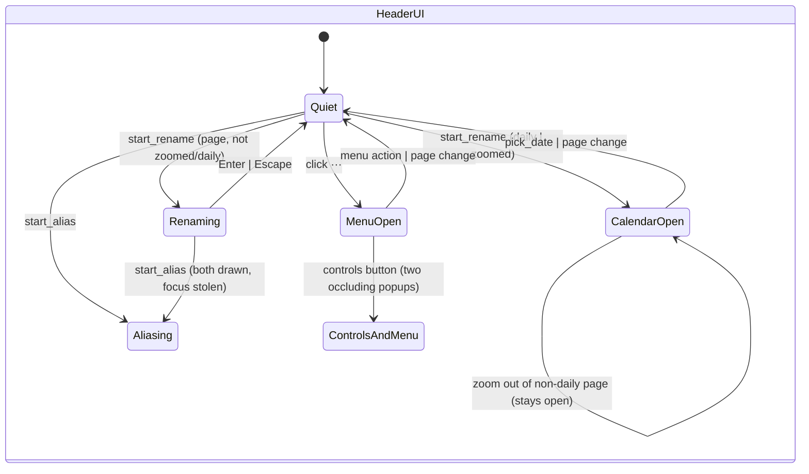

# Page view popups, inline inputs, hover and drag

## What it controls

The page header's transient UI (`crates/utopia-ui/src/page_view.rs`): the "···" page menu,
the rename and alias inline inputs, the date-picker calendar, the references controls
popover, plus the hovered row and block drag-and-drop.

## Where the state lives

| Piece | Location | Set | Cleared |
|---|---|---|---|
| Page menu | `page_view.rs:341` `page_menu: bool` | toggle `:2756` | `:622, :2489, :2498, :2507, :2518, :2535, :2542` |
| Rename | `:329` `rename: Option<Entity<LineInput>>` | `:2016` | `:605, :2008, :2021` |
| Alias | `:334` `alias_input: Option<Entity<LineInput>>` | `:2896` | `:608, :2874, :2889` |
| Calendar | `:331` `show_calendar: bool`, `:335` `calendar_month` | toggle `:1986`; `:1988, :2064` | `:606, :2046` |
| Controls popover | `:327` `controls_menu: Option<ControlMenu>` | `:3094, :3120` | `:623, :3234` |
| Input subscriptions | `_subs` pushed at `:2014`, `:2894` | per start | never |
| Hovered row | `:344` `hovered_row: Option<BlockId>` | `:2352-2368` | never on `show` |
| Drag payload | `DraggedBlock :264-268` created per row `:2296-2303`; drop target snapshot `:2319` | gpui owns the drag | – |
| Open embeds | `:328` `open_embeds: HashSet<(BlockId, String)>` | toggle `:1862-1866` | never |

## States

Five independent popup/input flags → up to 2×2×2×2×3 = 48 combinations; nothing enforces
mutual exclusion. Hover: `None` / `Some(row)`. Drag: gpui-owned; the view sees only
`drag_over` styling (`:2348`) and `on_drop` (`:2349-2351`).

## Events and transitions

- "···" click → `page_menu` toggle; menu actions clear it.
- `start_rename :1984-2017`: if daily or zoomed → toggles `show_calendar` instead; else creates
  a `LineInput`, subscribes, focuses. `finish_rename :2020`, cancel `:2008`.
- `start_alias :2866-2897`: same shape, no check of `rename`.
- Controls button → `controls_menu` toggle; pick → `:3234` clears.
- Row hover enter/leave → `hovered_row` with a race workaround (`:2355-2363`).
- Drop → `drop_block :1926-1951` re-reads the store using only `target.page`/`target.block`.

## Impossible or unhandled combinations (evidence)

1. **Two occluding popups at once.** `page_menu` and `controls_menu` toggle independently
   (`:2756` vs `:3094/:3120`); both render `deferred().with_priority(1)` + `occlude()`
   (`:2550`, `:3243`). No click-outside dismissal exists in this file; whether the workspace
   closes them is uncertain.
2. **Rename and alias inputs open together.** `start_alias :2866` does not check `rename`
   and vice versa (`:1984`); both call `window.focus` (`:2015`, `:2895`), so the second steals
   focus while the first stays drawn.
3. **Subscription leak.** Every `start_rename`/`start_alias` pushes a `Subscription` into
   `_subs` (`:2014`, `:2894`) that is never removed after the entity is dropped at
   `:2008/:2021/:2874/:2889`; `_subs` grows for the life of the view.
4. **Calendar left open over a normal header.** See `page-view-mode.md` item 3
   (`:1985-1991` vs `:606/:2046`, rendered at `:2781`). Its `existing` set is a fresh empty
   `HashSet` every frame (`:2783`) — dead state.
5. **`hovered_row` outlives the page.** Not in the reset list (`:602-621`); only mutated at
   `:2357-2366`. If the same `BlockId` reappears (an embed of it on the next page), that row
   renders hovered. The race workaround at `:2355-2363` handles "false after true" for the
   old row; a "true for old after true for new" ordering (if gpui can produce it) is not
   handled — uncertain.
6. **`open_embeds` is global across pages** and keeps `has_embeds()` true forever after the
   first toggle (see `page-view-rebuild-cycle.md` item 2).
7. **Drop target is a render-time snapshot** (`:2319`), but `drop_block` only uses ids and
   re-reads the store, so a stale snapshot cannot corrupt structure. Cross-page drops
   (`:1930-1951`) skip `apply_plan`/`rebuild` and rely on `Changed { structural: true }`
   (`:1947`), which `:433` matches. Fine.

## Diagram



## Would an explicit state type help?

Yes, for the header: one `Option<HeaderPopup>` makes exclusivity structural and lets a
single `close()` drop the input entity and its subscription together.

```rust
enum HeaderPopup {
    Menu,
    Controls(ControlMenu),
    Rename { input: Entity<LineInput>, _sub: Subscription },
    Alias  { input: Entity<LineInput>, _sub: Subscription },
    Calendar { month: NaiveDate },
}
struct PageView { popup: Option<HeaderPopup>, .. }   // show(): self.popup = None
```

`hovered_row` and `open_embeds` just need to be in the per-page reset.
