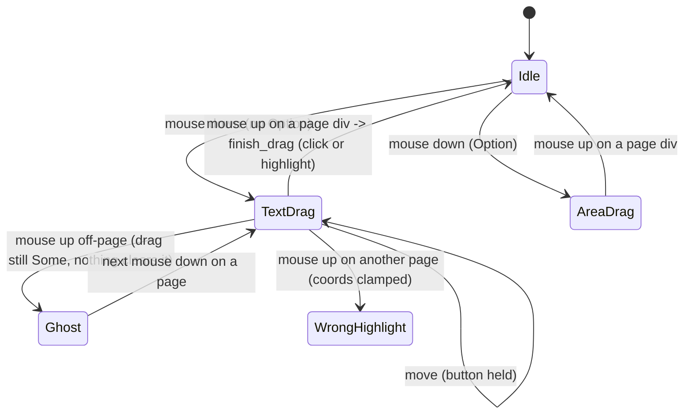

# PDF viewer highlight drag: text selection vs area, click vs drag

## What it controls

Creating a highlight in the PDF viewer (P2, macOS): dragging selects text lines, Option-drag
selects an area, a tiny drag is a click. `crates/utopia-ui/src/pdf_view.rs`.

## Where the state lives

| Piece | Location | Set | Cleared |
|---|---|---|---|
| Drag | `pdf_view.rs:44` `drag: Option<(page, start, cur)>` | mouse down `:305`; move `:312` | `finish_drag` `take()` `:243` |
| Mode | `:46` `area_drag: bool` | from the Option key at mouse down `:303` | never |
| Preview rects | `:48` `preview: Vec<[f32; 4]>` | `:304`, `:314-319` | `:242` |

Read elsewhere: `pdf_view()` in `crates/utopia-app/src/main.rs:112, 122`.

## States

**Idle** (`drag = None`) / **Text drag** (`drag = Some`, `!area_drag`, preview live) /
**Area drag** (`drag = Some`, `area_drag`) / **Click** (rect below threshold at
`:256-259`).

## Events and transitions

- mouse down on a page div → `drag = Some`, `area_drag = alt`, preview seeded.
- mouse move with `pressed_button == Some(Left)` (`:311`) → update `cur`, preview.
- mouse up **on a page div** (`:325-328`) → `finish_drag :238-260`: clamp to 0..1, click vs
  highlight, store as a quote block.

## Impossible or unhandled combinations (evidence)

1. **Release off-page leaves a ghost selection.** The up handler is attached per page div
   (`:325-328`); there is no view-level up handler and `mouse_move` never clears `drag` when
   it sees no button pressed (`:311`, contrast `graph_view.rs:340`). Releasing in the gutter,
   header or outside the window leaves `drag = Some` with no button held; the rectangle keeps
   rendering (`:376-394`) until the next mouse down on a page.
2. **Release on a different page clamps into a wrong highlight.** `finish_drag` runs with the
   releasing page's coordinates against the original page's bounds, clamped to 0..1
   (`:238`), producing a highlight that runs to the page edge and is written as a block (rule
   5 is not violated — nothing is lost — but a wrong block is created).
3. `area_drag` is stale between drags; harmless because it is only read while `drag` is
   `Some` (`:260, :313`).

## Diagram



## Would an explicit state type help?

Yes, with the page id in the variant and a view-level mouse-up:

```rust
enum Gesture { Idle, Drag { page: usize, mode: DragMode, start: Point, cur: Point } }
enum DragMode { Text, Area }
// on_mouse_up at the view root: finish only if event.page == drag.page, else cancel
// on_mouse_move: if pressed_button.is_none() { gesture = Idle }
```
