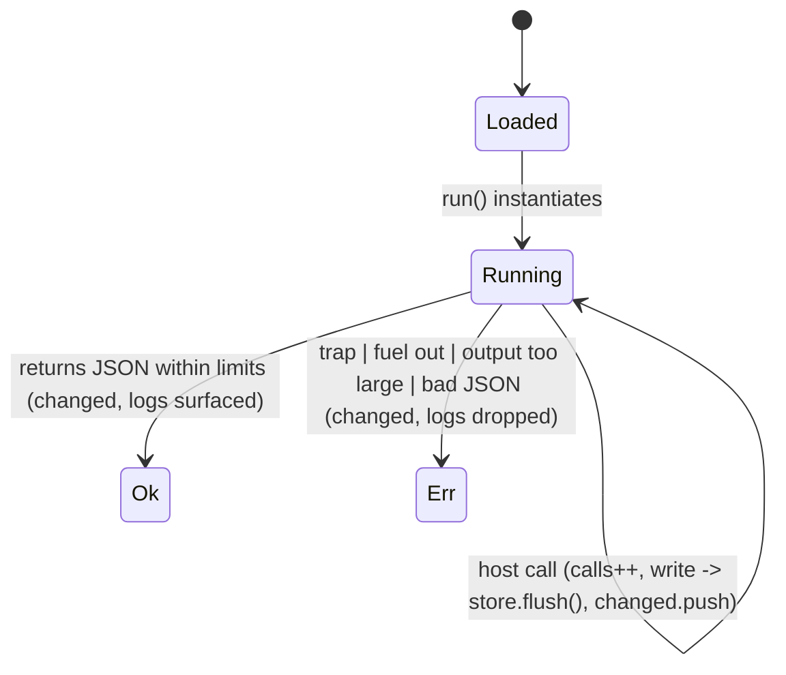

# Plugin run: fuel, host-call counter, changed pages

## What it controls

One execution of a WASM plugin command (P2): instantiation, fuel and host-call limits,
permissioned store access, and what the UI learns afterwards (inserted text, message, pages
changed). `crates/utopia-plugin/src/lib.rs`.

## Where the state lives

| Piece | Location | Notes |
|---|---|---|
| Host state | `plugin/lib.rs:123-130` `Host { calls, limits, changed, logs, store: *mut Store }` | per run |
| Fuel | set at `:268`; `fuel_used = FUEL_PER_RUN - get_fuel().unwrap_or(0)` (`:336`) | – |
| Host calls | `calls` incremented `:181`, cap `:182-184` (over-cap returns error JSON; execution continues until fuel ends) | – |
| Permissions | `can_read`/`can_write` (`:69-75`, read ⊂ write at `:70`) against `Op::writes()` (`utopia-api/src/lib.rs:98-103`) | parallel hand-maintained list |
| Pages changed | `host.changed` pushed at `:203` when a write op runs | returned only on `Ok` (`:346-354`) |

## States

**Loaded** (validated) → **Running** (instance alive) → **Finished Ok(RunOutput)** or
**Finished Err(Run)**.

## Events and transitions

- `run` (`:260-354`): instantiate, alloc input, call; unpack; size check; parse JSON; build
  `RunOutput { changed: host.changed, logs: host.logs, .. }`.
- host write call → `utopia_api::handle` → `store.flush()` (`api/lib.rs:274, :292, :336`) —
  **committed inside the call**.

## Impossible or unhandled combinations (evidence)

1. **Writes committed, UI never told.** A write host call flushes the store and records the
   page in `host.changed` (`:203`). If the module then traps, exhausts fuel, returns too much
   output, or returns non-JSON, `run` returns `Err` at `:324-326 / :329 / :334 / :342` and
   `host.changed`/`logs` are dropped — only the `Ok` path surfaces them (`:346-354`). The
   store has changed but no `Changed` event carries the pages, so views stay stale until
   something else rebuilds. Rule 13 ("every plugin write goes through the same command path")
   holds for the write; the notification half does not.
2. **`Op::writes()` is a parallel list.** Every mutating `handle` arm today (`Capture`,
   `UpdateBlock`, `AppendBlock`, `api/lib.rs:269-341`) is listed; a new write op must be
   added by hand or it runs with read permission.
3. **`fuel_used` reports full consumption** if `get_fuel` errs (`:336`). Cosmetic.

## Diagram



## Would an explicit state type help?

Return the host state on both paths:

```rust
pub struct RunResult { pub outcome: Result<RunOutput, PluginError>, pub changed: Vec<PageId>, pub logs: Vec<String>, pub fuel_used: u64 }
```

and derive the permission oracle from the op itself (`impl Op { const fn kind(&self) -> OpKind }`)
so `writes()` cannot drift from `handle`.
