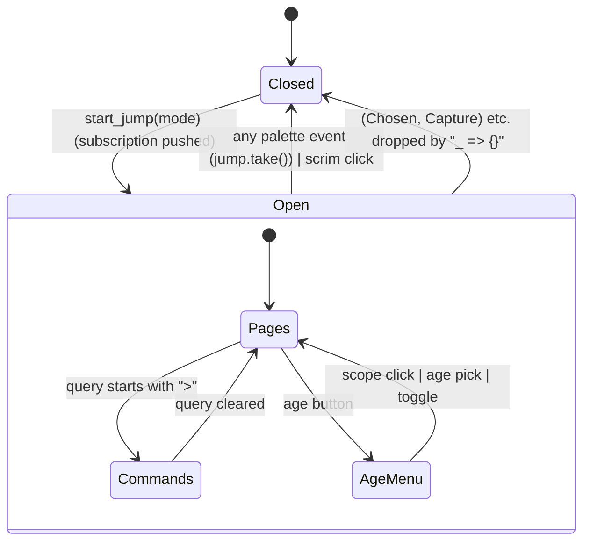

# Quick jump palette (Cmd+K): open/closed, mode, rows, selection

## What it controls

The command/jump palette: whether it is open, which mode it serves (open page, search,
redirect a link, capture, extract, free text), the result rows and highlighted row, the
scope/age filters, and which events the workspace honours.
`crates/utopia-ui/src/workspace.rs` and `crates/utopia-ui/src/quick_jump.rs`.

## Where the state lives

| Piece | Location | Notes |
|---|---|---|
| Open + mode (workspace side) | `workspace.rs` `jump: Option<(Entity<JumpPalette>, JumpMode)>`; `JumpMode :69-76` carries payload | `take()`n on **any** palette event (`:870`), cleared by the scrim (`:2924`) |
| Mode (palette side) | `quick_jump.rs` `mode: PaletteMode` | mapped from `JumpMode` at `workspace.rs:848-854` |
| Rows / selection | `rows`, `selected` | rebuilt together (`:311-312, :327-328, :340-341`) except two early returns (`:300-303`, `:335-338`) |
| Filters | `scope`, `age`, `age_menu: bool` | `age_menu` closes at `:823, :886, :837` |
| Preview / recent | `preview`, `recent: Option<..>` | `preview` cleared at `:299`; `empty_state` returns nothing when `recent` is `None` (`:461-464`) |
| Subscriptions | `workspace.rs` `subs` pushed at `:866` per open | never pruned |

Read elsewhere: `jump_palette()` in tests (`tests/workspace.rs:1684ff`); `search_for`
pokes the input (`workspace.rs:1157-1160`).

## States

**Closed** / **Open(mode)** for each `JumpMode` × palette rows **populated/empty** ×
`age_menu` open/closed.

## Events and transitions

The dispatch at `workspace.rs:871-930` is a partial `match (event, mode)` with `_ => {}`:
honoured are `(Chosen, Open|Search)`, `(Chosen, Redirect)`, `(ChosenDay, Open)`,
`(RunCommand, _)`, `(Text, Capture)`, `(Text, Extract)`. Every event closes the palette first
(`:870`).

## Impossible or unhandled combinations (evidence)

1. **Silently dropped pairs.** `(Chosen|ChosenDay, Capture|Text|Extract)`, `(ChosenDay,
   Redirect|Search)`, `(Text, Open|Search|Redirect)` and `Dismissed` fall to `_ => {}`. Most
   are unreachable because `choose` emits per mode (`quick_jump.rs:529-576`), but the
   palette and the workspace each hold half the rule.
2. **Command runs during a redirect.** In `Redirect` mode the palette is `PaletteMode::Pages`,
   so typing `>` lists commands (`quick_jump.rs:305-315`) and `RunCommand` is honoured for any
   `JumpMode` (`workspace.rs:898`): the command runs and the redirect is abandoned without a
   message.
3. **Stale `selected` after two early returns.** Capture/Text (`:300-303`) and Search with an
   empty query (`:335-338`) clear `rows` but leave `selected`. Harmless today: `step`
   guards `n == 0` (`:511-513`) and `choose` falls to "nothing matched" (`:537-548`).
4. **`age_menu` is not closed by Escape** (Cancel dismisses the whole palette, `:267`) nor by
   clicking elsewhere inside the palette.
5. **Two mode enums** (`JumpMode` with payload, `PaletteMode` without) must be kept in step
   by the mapping at `workspace.rs:848-854`.

## Diagram



## Would an explicit state type help?

Yes: fold the mode into the palette so it emits exactly the events the mode allows, and make
the workspace handler total.

```rust
enum PaletteOutcome {
    OpenPage(PageId), OpenDay(NaiveDate), Redirect { from: PageId, to: PageId },
    Capture(String), Extract(String), RunCommand(&'static str), Dismissed,
}
// JumpPalette::new(mode) stores the payload; emits PaletteOutcome; Workspace matches exhaustively.
```
