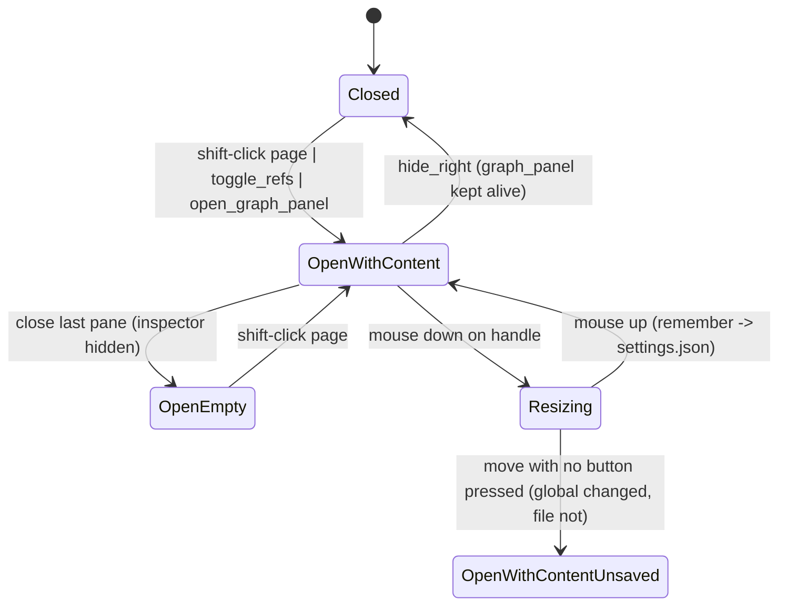

# Right sidebar: open/closed, inspector, panes, graph panel, resize drag

## What it controls

The right sidebar (`§9.2`): whether it is shown, whether the inspector is one of its
contents, the stack of shift-clicked page panes (each foldable), the sidebar graph panel, and
the drag-to-resize gesture whose result goes to `settings.json` (rule 9).
`crates/utopia-ui/src/workspace.rs`.

## Where the state lives

| Piece | Location | Set | Cleared |
|---|---|---|---|
| Shown | `right_open: bool` | `:812, :994, :1333, :1446` | `:1370` |
| Inspector | `inspector_open: bool` | `:1444/:1447` | `:1444` |
| Panes | `panes: Vec<SidePane { collapsed: bool, .. }>` | insert `:811`; fold `:2853` | close `:741-745`, `:2879-2886` |
| Graph panel | `graph_panel: Option<..>` | `:995` | `:966, :1035, :1040` |
| Drag | `resize_from: Option<(f32, f32)>` | `:2767` | `:1381, :1396` |
| Width (copy 1) | `right_width: f32` (`:150`) | `:1388, :1399, :1509` | – |
| Width (copy 2) | `Appearance` global (`appearance.rs:509-512`) | per pixel `:1389` | – |
| Width (copy 3) | `settings.json` via `remember` (`appearance.rs:577-583`) | `resize_done :1400` | – |

## States

**Closed** / **Open-empty** (no panes, no inspector, no panel → hint text `:2803-2811`) /
**Open with content** / **Resizing** (`resize_from = Some`).

## Events and transitions

- `toggle_refs` (`:1442-1450`): if open and inspector shown → hide inspector only; else open
  both.
- `toggle_right` (`:1324-1336`), `hide_right` (`:1358-1372`: ends edits hosted in panes,
  takes focus from the graph panel, leaves `graph_panel` alone).
- Pane fold (`:2847-2853`) ends the edit first; re-opening a page already in a pane moves it
  to the top and keeps its fold (`:784-790`).
- `resize_start :2767` → `resize_move :1376-1391` → `resize_done :1394-1403`.

## Impossible or unhandled combinations (evidence)

1. **Width applied but not saved when the drag ends without a mouse-up.** `resize_move`
   (`:1380-1383`) does `if e.pressed_button.is_none() { self.resize_from = None; return; }` —
   ending the drag without `remember()`. Each earlier move already wrote the global
   (`:1389`), every window draws the new width, and `refresh :1508-1510` re-reads it from the
   global each frame, but `settings.json` keeps the old value until some other preference
   saves the whole `Prefs` (any `prefs.save`, e.g. `appearance.rs:589`). Settings → Appearance
   "Width: N px" (`settings.rs:1466-1480`) reads the global, so it reports the unsaved value
   as if persisted.
2. **Open-empty is reachable and sticky.** Close the last pane after `toggle_refs` hid the
   inspector: `right_open` stays true with only the hint. No auto-close.
3. **Hidden graph panel keeps computing** (`graph_panel` alive while `right_open == false`,
   `:1370`; observers at `:341-346`, `:351-355`). See `workspace-main-pane-content.md`.

## Diagram



## Would an explicit state type help?

For the width, yes: a single owner with a `dirty` bit.

```rust
enum Resize { Idle, Dragging { start_x: f32, start_width: f32 }, EndedUnsaved }
// resize_move: if pressed_button.is_none() { self.resize = EndedUnsaved; return self.persist_width(cx) }
```

For the sidebar contents an enum is overkill; the three width copies are the problem.
