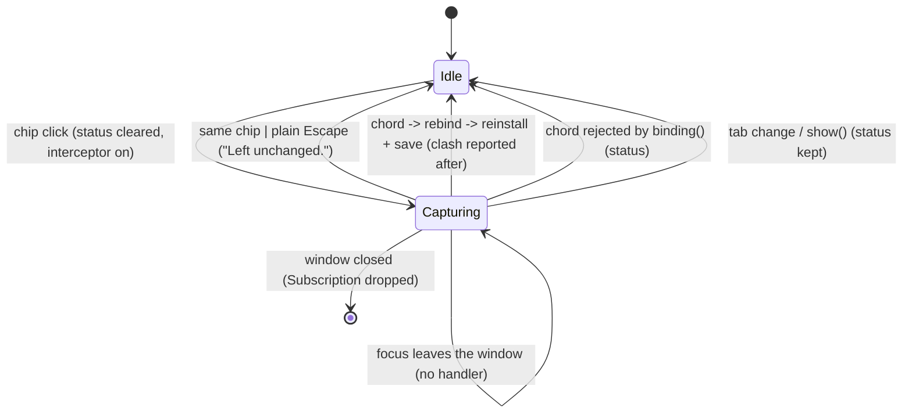

# Settings: keybinding capture

## What it controls

Whether the next keystroke in the Settings window is swallowed by a gpui keystroke
interceptor and recorded as the binding for one action (`§9.1`, AGENTS.md "Settings and
keybindings"), and what the status line says afterwards. `crates/utopia-ui/src/settings.rs`.

## Where the state lives

| Piece | Location | Set | Cleared |
|---|---|---|---|
| Action being captured | `settings.rs:137` `capturing: Option<&'static ActionDoc>` | `start_capture :241` | `cancel_capture :230` |
| Interceptor | `:139` `capture: Option<Subscription>` | `:246` | `:231` |
| Owning window | `:141` `window: Option<AnyWindowHandle>` | `:244` | **never** (and never read: the closure captures its own `handle`, `:243, :248`) |
| Status line | `:142` `status: Option<SharedString>` | 15+ sites (`:206, :267, :275-276, :305, :321, :334, :340, :349, :464, :480, :492, :511, :525, :546, :1063`) | only `start_capture :242` |
| Overrides | `:134` `overrides: Overrides` | load `:167`; rebind `:287/:289`; reset `:319, :338` | – |
| Live keymap | gpui bindings via `reinstall :347` (`actions.rs:1056-1059`) | – | – |
| File | `keymap.json` via `overrides.save :348` (`actions.rs:958-961`) | – | – |

Tests drive it directly (`tests/settings.rs:26, 74, 109, 135, 159, 519` `start_capture`;
`:28, :36, :79, :477, :485` `capturing()`) and via clicks on `settings-chip-GoToday` (`:473`).

## States

**Idle** (`capturing = None`, `capture = None`) / **Capturing(d)** (both `Some`). There is
no "recorded, awaiting confirm" state: a chord is consumed and bound in one step
(`:260-281`); the clash question is answered after the write (`:292-304`). The two fields
always move together (`:241+246`, `:230+231`).

## Events and transitions

| Event | Handler | Result |
|---|---|---|
| Click chip, Idle | `:1060-1067` → `start_capture :235-257` | Capturing(d), `status = None`, interceptor installed |
| Click the same chip, Capturing | `:1061-1064` | Idle, "Left unchanged." |
| Click another chip, Capturing | `:1065-1066` | Capturing(d2); old `Subscription` dropped by the assignment at `:246`; no status for the abandoned one |
| Keystroke in another window | `:248-250` | ignored, not swallowed; still Capturing |
| Modifier-only key | `:262-264` | swallowed, still Capturing (gpui 0.2.2 synthesises lone modifiers on `ModifiersChanged`, which interceptors never see — the guard is for a path gpui does not take; uncertain for other layouts) |
| plain `escape` | `:266-270` | Idle, "Left unchanged.", nothing written |
| `escape` with a modifier | `:266` fails `has_modifier` → `:271-280` | treated as a chord and **bound** (`binding()` accepts it, `actions.rs:801-809`) |
| other chord | `rebind :283-316` → `apply :344-351` | reinstall, save, clash computed after the fact |
| chord `binding()` rejects | `:274-278` | Idle, "… cannot be used as a shortcut." |
| Tab click / `show()` | `:217-227` → `cancel_capture` | Idle, **status untouched** |
| Focus loss (click into main window, Cmd+Tab) | none | still Capturing; chip keeps saying "Press keys…" (`:1055-1056`) |
| Settings window closed | none; view dropped with the window → `Subscription` dropped | Idle by destruction; `SettingsWindow` global keeps a stale handle until the next Cmd+, (`main.rs:587-598`) |

## Impossible or unhandled combinations (evidence)

1. **`window` is write-only dead state** (`:244`; `grep "self.window"` finds only that
   line). A reader will assume it means "which window owns the capture"; it is never cleared.
2. **Capture is app-global and survives focus loss.** The interceptor is registered on
   `App` (any window); only the `handle` check at `:248` scopes it. No blur handler ends it,
   so a user who clicked away sees "Press keys…" when they return.
3. **`escape` is not a universal cancel**: `cmd-escape`/`shift-escape` bind (`:266`).
4. **`status` is one slot for five unrelated flows** (capture, reset, appearance, pins,
   startup warnings); only `start_capture` clears it (`:242`). A startup warning
   (`"keymap.json: …"`, `:206`) is erased by the first chip click and never returns.
5. **Keystroke while the filter `LineInput` has focus and capturing**: the interceptor runs
   first and swallows it, so the field's own Escape never fires and the filter is not cleared
   — two meanings of Esc depending on a hidden state. Consistent, but invisible.
6. **Interceptor cancels itself from inside its callback** (`:265`): drops the `Subscription`
   while gpui iterates a clone of the set — safe by gpui's construction.

Clash detection is covered in `keymap-overrides-three-copies.md`.

## Diagram



## Would an explicit state type help?

Yes, mostly to make focus loss and "escape with modifiers" visible, and to drop `window`.

```rust
enum Capture {
    Idle,
    Listening { action: &'static ActionDoc, _interceptor: Subscription, window: AnyWindowHandle },
}
enum Captured { Cancel, Chord(Keystroke) }   // Escape (any modifiers) => Cancel
// on_blur of the Settings window's focus handle => Capture::Idle + status "Capture cancelled."
```

A separate `status: Option<(StatusSource, SharedString)>` would stop unrelated flows from
overwriting each other.
