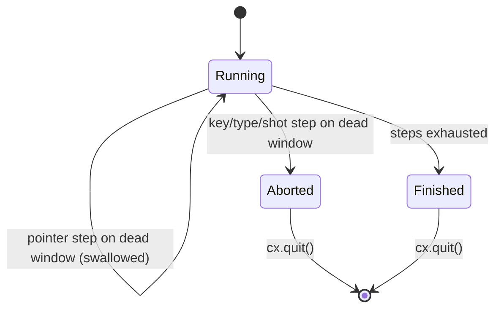

# Shot script sequencer (`UTOPIA_SHOT_SCRIPT`)

## What it controls

The scripted driver that types, clicks, waits, switches target window and captures PNGs
for verification (AGENTS.md "Looking at the UI"). `crates/utopia-app/src/shot.rs:106-237`.

## Where the state lives

| Piece | Location | Notes |
|---|---|---|
| Target window | `shot.rs:112` `handle: AnyWindowHandle` (current), `:109` `main` | `Target main|last` (`:132-154`); `last` = `cx.windows().last()` (`:138`), gpui's order, not `SettingsWindow` |
| Step cursor | implicit: the `for` loop at `:120` | – |
| Continue/stop | `r: Result` per step (`:121`, `:228-230`) → `break` then `cx.quit()` (`:236`) | – |
| Pacing | 60 ms between steps (`:232-234`); explicit `wait` steps | no readiness signal |

## States

**Running(step i, target)** → **Finished** (quit) / **Aborted** (first step error → quit).

## Impossible or unhandled combinations (evidence)

1. **Inconsistent error policy per step kind.** `Keys`/`Type`/`Drop`/`Ws`/`Shot` propagate a
   dead-handle error and end the run (`:181-230`); `Scroll`/`Click`/`Move`/`Hover` swallow it
   and return `Ok(())` (`:158-179`: `if let Ok(Some(..)) = target { .. } Ok(())`). After
   `target last` points at a window that then closes, a `click` is silently skipped while
   the next `keys` aborts the script.
2. **No liveness check after `wait`** for the targeted window; `Target` with no windows logs
   and keeps the old handle (`:149-152`).
3. **Script spawned regardless of `RootState`** (`main.rs:217-227`); `ws`/`drop` steps no-op
   on the onboarding or lock screen (`ScriptHooks::workspace` returns `None`, `:52-57`).

## Diagram

## Would an explicit state type help?

Marginal. One `enum StepOutcome { Done, Skipped(&'static str), Fatal(anyhow::Error) }`
returned by every arm, logged uniformly, would remove the asymmetry; `Target` should
validate the handle (`handle.update(cx, |_,_,_| ())`) before switching.
