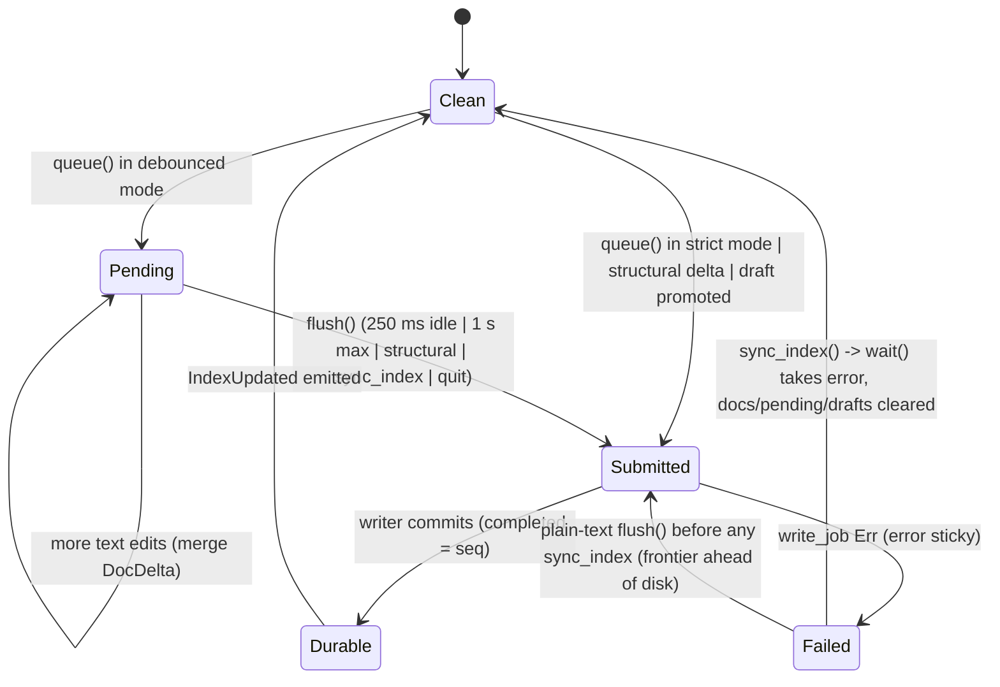

# Store commit pipeline: strict vs debounced, pending edits, writer progress

## What it controls

How an in-memory CRDT edit becomes a durable SQLite transaction (AGENTS.md rule 2, PRD
`§13.3`): whether a commit ships now or waits, when the index can be read, when
`IndexUpdated` fires, and what happens when the writer thread fails. The machine is spread
across three layers that each keep their own flags:

- `Store` (`crates/utopia-store/src/lib.rs`): `debounced`, `pending`, `persister`.
- `Persister` / `Shared` (`crates/utopia-store/src/writer.rs`): `Inline` vs `Thread`,
  `Progress { completed, error }`, `WriteTicket`.
- `AppState` (`crates/utopia-ui/src/app_state.rs`): `dirty_since`, `flush_task`,
  `wait_task`, `version`, `refs_version`.

## Where the state lives

| Piece | Location | Meaning |
|---|---|---|
| Mode | `lib.rs:122` `debounced: bool`; set at `:214-220` | strict (default) vs debounced (UI, `app_state.rs:56`) |
| Unflushed pages | `lib.rs:119` `pending: Vec<(PageId, Option<DocDelta>, bool)>` | queued at `:353-382`, drained at `:271-327`, cleared on error at `:337` |
| Writer kind | `writer.rs:216-226` `Persister::{Inline, Thread}` | in-memory graphs write inline |
| Jobs submitted / done | `writer.rs:224` `submitted: u64`; `:108` `completed: u64` | ticket target vs progress |
| Sticky failure | `writer.rs:109` `error: Option<String>` | set via `get_or_insert` (`:258`, `:292`), cleared only by `Persister::wait` (`:369`) |
| Tag-page cache | `writer.rs:118` `tag_pages: Mutex<Option<HashSet>>` | `None` = never classified (`:142-150`) |
| UI idle timer | `app_state.rs:45` `dirty_since: Option<Instant>` | first unflushed edit; cleared at `:117` |
| UI flush task | `app_state.rs:46` `flush_task: Option<Task<()>>` | the 250 ms timer; overwritten at `:108` |
| UI wait task | `app_state.rs:47` `wait_task: Option<Task<()>>` | waits on a ticket; overwritten at `:125` |

## States

Store side: **Clean** (`pending` empty) → **Dirty-debounced** (`pending` non-empty, no
flush) → **Submitted** (job on the channel, `completed < submitted`) → **Durable**
(`completed == submitted`) → or **Failed** (`error` set).

UI side: **Idle** → **Timer armed** (`dirty_since` set, `flush_task` set) → **Flushing**
→ **Waiting for ticket** (`wait_task` set) → **IndexUpdated emitted**.

## Events and transitions

- `execute_multi` (`lib.rs:643-693`) applies to the shard, then `queue(pages, true)`
  (`:683`). `queue` flushes immediately in strict mode or when a draft was promoted
  (`:377-381`); otherwise it only appends to `pending`. Structural or meta deltas force a
  `flush()` right after (`:686-688`).
- `AppState::changed(pages, structural)` (`app_state.rs:88-97`): structural → `flush_now`;
  else `schedule_flush`, which arms a 250 ms timer or flushes at once after 1 s of
  continuous dirtiness (`:99-112`).
- `flush_now` (`:115-131`): `store.flush()`, take a `WriteTicket`; if already done emit
  `IndexUpdated`, else spawn `wait_task`.
- `Store::flush` (`lib.rs:271-327`): builds one `Job`; **before** submitting it sets
  `entry.persisted = frontier` and `entry.has_snapshot = true` (`:303-304`). With a
  `Thread` persister, `submit` only sends on the channel (`writer.rs:288-297`) so `Ok` here
  does not mean durable.
- `sync_index` (`lib.rs:331-341`): `flush` + `persister.wait`; on error drops **every**
  loaded shard, pending edit and draft (`:336-338`).
- `read_barrier` (`lib.rs:344-350`): strict mode waits for the writer; debounced mode never
  does, so index reads may lag (by design, rule 2).
- Writer thread (`writer.rs:247-265`): per job, run `write_job`, publish tag pages, set
  `completed = seq`, record the first error, `notify_all`.
- `WriteTicket::wait` (`writer.rs:201-213`) returns when `completed >= target` **or** when
  any error is set. `is_done` (`:192-198`) ignores `error`.

## Impossible or unhandled combinations (evidence)

1. **In-memory frontier runs ahead of disk after a failed job.** `flush` advances
   `entry.persisted` and `entry.has_snapshot` (`lib.rs:303-304`) before the writer has run.
   If `write_job` later fails (`writer.rs:250-259`), the error is recorded but the shard is
   not reloaded; the next `flush` exports only `export_since(&entry.persisted)` (`:290`),
   i.e. an update whose base the database never received, and `snapshot` is `None` because
   `has_snapshot` is already true (`:283`). The repair is `sync_index()` → `wait()` →
   `docs.clear()` (`:334-338`), which runs before every identity-affecting operation
   (`pages.rs:82,117,738`) and on quit (`app_state.rs:80`), but **not** on the next plain
   text flush. Between the failure and the next `sync_index`, every text edit on that page
   is committed to `page_update` relative to a missing base. `doctor`'s "incremental ==
   rebuild" check would catch the resulting shard, which is why this is listed as a rule-2
   risk rather than silent corruption. Uncertain: whether Loro tolerates importing an update
   with a missing dependency on reload (`load_doc`, `lib.rs:480-515`); if it does not, the
   page fails to load.
2. **The error is sticky but only visible to whoever calls `Persister::wait` next.**
   `Progress.error` is set with `get_or_insert` (`writer.rs:258`) and taken by `wait`
   (`:369`). `WriteTicket::wait` exits early while the error is set (`:207`), so the UI's
   `wait_task` resolves and `index_updated` fires `IndexUpdated` (`app_state.rs:133-143`)
   for a commit that did not happen. The failure surfaces later, in whichever operation
   happens to call `sync_index` (e.g. a rename), where it is reported as that operation's
   error.
3. **`sync_index` on error also clears `drafts`** (`lib.rs:338`), while `PageView` keeps the
   draft's `PageId` (`page_view.rs:240,945`). A later `page_state(page)` runs `load_doc`,
   which finds no `page_doc` row for a page that was never written and returns `NotFound`
   (`lib.rs:490-491`). See `draft-daily-page.md`.
4. **`dirty_since` is only reset by `flush_now`.** `schedule_flush` returns early when
   `!store.has_pending()` (`app_state.rs:100-102`) without clearing `dirty_since`. Sequence:
   a text edit arms the timer; a structural edit flushes (`flush_now` clears `dirty_since`,
   fine). But: `changed(.., structural=false)` with an empty `pending` (e.g. `page_view.rs:1767,
   1789, 2137` call `app.changed(Vec::new(), false, cx)` after local-only changes) leaves
   `dirty_since` as it was. If it was already `Some` from an earlier edit that a structural
   path flushed via `Store::flush` directly (not `flush_now`), the next text edit sees
   `now - first >= 1 s` and flushes immediately instead of debouncing. Harmless (an extra
   commit), but it shows that `dirty_since` and `pending` are two clocks for one fact.
5. **`flush_task` replacement cancels the timer but not the intent.** Each `schedule_flush`
   overwrites `flush_task` (`:108`), dropping the previous timer; the new timer restarts
   the 250 ms idle window. The 1 s cap depends on `dirty_since`, which is why (4) matters.
6. **Strict-mode `conn()` swallows the writer error.** `conn()` does `let _ =
   self.read_barrier()` (`lib.rs:207-210`); after a writer failure, a strict-mode read
   proceeds on a database that lacks the last commit, and the error is only reported by the
   next `sync_index`.
7. **Two persisters, one connection.** `open_with_key` first creates the store with
   `Persister::inline()` (`lib.rs:192`), then replaces it with `Persister::spawn`
   (`:150`). Nothing is submitted between the two, so no job is lost; noted because the
   `Inline` → `Thread` swap is a state change that `init` and `open_with_key` share by
   convention only.
8. **The writer keeps going after a failed job, producing orphan update rows.** The loop
   records the error and continues (`writer.rs:256-259`, no `break`). For a brand-new page
   the first job carries the snapshot (`!has_snapshot`, `lib.rs:283-285`) and the memory
   flag flips to true (`:304`). If that first job fails, every later job for the page ships
   only `update` (`:289-299`), which `write_job` inserts into `page_update` (`writer.rs:81-86`)
   while `page_doc` has no row. `load_doc` then returns `NotFound` (`lib.rs:482-491`) and
   `doctor` reports "live block without a shard" (`doctor.rs:148-150`) because
   `project_page_row` did insert the `page` row (`project.rs:321-338`). Rule 2.
9. **An early `?` in `flush` strands the taken pending list.** `std::mem::take(&mut
   self.pending)` (`lib.rs:275`) happens first; `snapshot()?` (`:285`) and `export_since(..)?`
   (`:290`) can return before `submit`. Pages already processed have `persisted` advanced
   (`:303`) with no job submitted (same loss path as item 1); pages not yet processed are no
   longer in `pending`, so `has_pending()` (`:223-225`) reports false and the UI stops
   scheduling flushes for them (`app_state.rs:100-101`). Likelihood uncertain (`export_since`
   fails only if the stored frontier hex is malformed, `doc/lib.rs:60-66`); the consequence is
   rule-5 loss.
10. **Strict-mode callers of `conn()` discard the sticky error.** Besides item 6, the API and
    FFI run in strict mode and call `conn()` (`utopia-api/src/lib.rs:150, :247`;
    `utopia-ffi/src/lib.rs:170`), where `read_barrier` → `persister.wait()` `take()`s the error
    (`writer.rs:369`) and the caller ignores it. After that `sync_index` returns `Ok`
    (`lib.rs:333-340`) and never clears `docs`, so the in-memory `persisted` frontier stays
    ahead of disk permanently. Every `read_barrier()?` in `query.rs` (e.g. `:476, :489, :494,
    :522, :530`) has the same take-once semantics: the first query after a failed commit
    errors, later ones succeed.

## Diagram



## Would an explicit state type help?

Partly. The mode flag plus `pending` is simple enough, but the writer's failure state is
the risky part: the shard's "persisted" bookkeeping should only advance when the job has
actually committed, and a failed writer should be a state the store is *in*, not an
`Option<String>` someone may or may not read.

```rust
enum WriterState {
    Healthy { submitted: u64, completed: u64 },
    Failed { at_seq: u64, error: StoreError },   // every submit/flush returns this until repaired
}

enum ShardPersistence {
    Fresh,                                       // no page_doc row yet: next flush must snapshot
    Durable { frontier: Frontier, log_len: i64 },
    Submitted { base: Frontier, head: Frontier, job: u64 },  // promote on completion, roll back on failure
}
```

With `Submitted` carrying the job number, the writer's completion callback can promote
`persisted` and a failure can reset it, removing drift (1) at the source.
