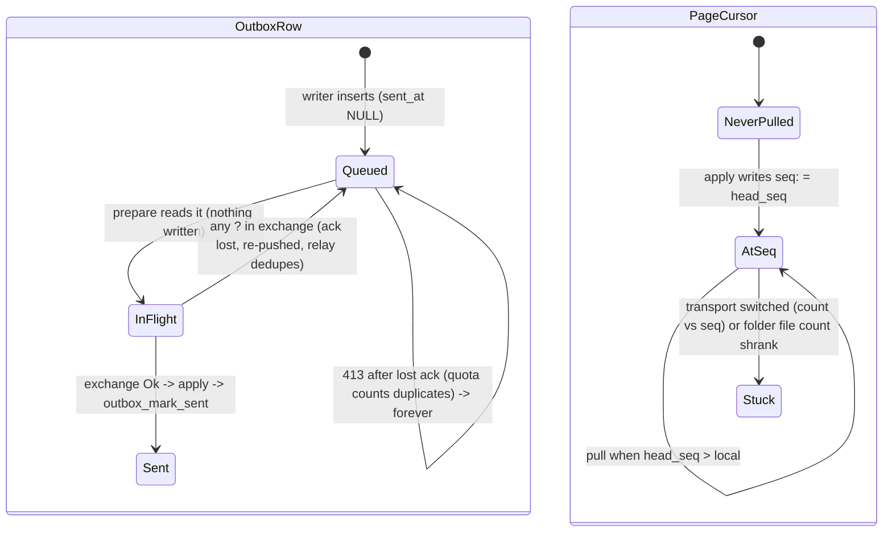

# Sync engine: outbox lifecycle and the per-page pull cursor

## What it controls

Which local updates get pushed and re-pushed, the "N changes queued" number, which pages get
pulled and from which `seq`, and whether the manifest is re-fetched (PRD `§12.3`, `§12.6`).
`crates/utopia-sync/src/lib.rs` on top of `crates/utopia-store` tables `outbox` and
`sync_state`.

## Where the state lives

| Piece | Location | Set | Cleared |
|---|---|---|---|
| Queued vs sent | `outbox.sent_at` (`schema.rs:97-105`) | `outbox_mark_sent` (`lib.rs:903-910`, read conn, one autocommit per row) | never deleted |
| In flight | nowhere — the lifetime of the `Outgoing` value on the background thread (`sync/lib.rs:159-170`) | `prepare :286-320` | `exchange` returns |
| Acks | `Incoming.sent/accepted/duplicates` (`:175-177`) | `exchange :203-209` per page | dropped on any `?` in `exchange` |
| Pull cursor | `sync_state["seq:<page>"]` (`:189-191`) | `apply :367-369` from `resp.head_seq` | never; not namespaced by transport or relay |
| Manifest rev | `sync_state["rev"]` | `apply :370-372` | never |
| Client id | `sync_state["client_id"]` | once `:258-265` | – |
| Enqueue flag | `pending[..].2` sticky per page (`store lib.rs:372`); payload = everything since `persisted` (`:290, :311`) | – | – |

Readers: `SyncStatus::from_result` → `workspace.rs:516, 562`; `SyncClient::queued`
(`:434`); FFI `:291`.

## States

Per outbox row: **Queued** (`sent_at IS NULL`) → **In flight** (unrecorded) → **Sent**.
There is no **Acked-but-unmarked** state, yet it occurs (below). Per page cursor: **Never
pulled** (no key) → **At seq N**.

## Events and transitions

- `prepare` (`:278-328`): `sync_index`; read `outbox_pending(10_000)`; batch per page under
  `MAX_PUSH_BYTES`; read cursors; drain `pending_snapshots`; pick ≤8 blobs each way.
- `exchange` (`:195-248`): manifest (always `manifest(None)`, `:197`); version check; push
  each page (`:203-209`); snapshots; blobs; second manifest only if something was sent
  (`:224-231`); pull pages with `head_seq > local` (`:235-238`); collect compaction wants.
- `apply` (`:332-386`): mark sent, mark blobs, store verified blobs, `import_batch`, write
  cursors and rev, `synced_at`, queue snapshots.

## Impossible or unhandled combinations (evidence)

1. **All-or-nothing exchange loses acks.** Any `?` inside `exchange` (`:197, :204, :211,
   :215, :220, :230, :237`) drops the whole `Incoming`, including `sent` for pages the relay
   already accepted. Those rows stay queued and are re-pushed; relays dedupe by change id
   (`syncd/lib.rs:279-287`, `relay.rs:70-73`, `folder.rs:120-123`), so correctness holds, but
   (a) `Offline { queued }` over-counts rows the relay already has (`:150-152`), (b)
   bandwidth is re-spent each round, and (c) one failing page blocks every later page's push
   *and all pulls* because the pull section follows the push loop (head-of-line, pages
   iterate in `BTreeMap` order `:292, :203`).
2. **Permanent 413 after a lost ack.** `syncd` checks quota before dedupe and outside the
   transaction (`syncd/lib.rs:266-269`, then dedupe at `:278-287`). A 900 KB batch stored
   when the graph is within 100 KB of quota, whose response is lost, is re-pushed forever:
   `graph_bytes + 900 KB > quota` → 413 → client maps to `Transport` (`http.rs:37-40`) →
   `Offline` → retried at ≤60 s with 0 new bytes ever stored. No quota/read-only state exists
   on the client. (`put_blob` checks existence first, `syncd:162-167`, so blobs are fine.)
3. **The cursor means different things per transport.** `FolderTransport` reports
   `head_seq` = **file count** (`folder.rs:89, :96`) and `pull` ignores `since` and returns
   every file (`:138-154`); the engine stores that count under the same `seq:<page>` key.
   (a) Folder: local `seq:p = 10`; a sync tool drops two files (count 8), a peer adds two
   (count 10) → `10 > 10` false (`:236`) → the two new updates are never pulled until the
   count reaches 11. (b) Switching the same graph file from Folder (count 500) to a fresh
   relay (head 3) or vice versa → `3 > 500` false → nothing is pulled until the relay has
   > 500 entries. No reset path exists (no `sync_set("seq:…", "0")` anywhere).
4. **A poison page halts every round.** One failing pull (`:237 ?`) — e.g. an E2E `open`
   error when the relay holds a plaintext page from a device without the passphrase
   (`e2e.rs:65-69`) — drops the `Incoming`, so `rev` and every cursor advanced earlier in the
   loop are not persisted and `apply` never runs. Each round re-downloads the same pages,
   fails on the same one, and shows `Offline { queued }`. There is no per-page failure state
   and nothing records "this graph's relay holds mixed payloads".
5. **Partial apply.** `apply` marks outbox sent (`:333`) and blobs uploaded (`:334`) before
   `import_batch` (`:365`); on import error those marks persist while cursors, `rev` and
   `synced_at` (`:373`) do not — "Synced … ago" goes stale while the status says Offline.
6. **Conditional manifest is dead code.** `exchange` never passes `if_none_match` (`:197`),
   so the ETag/304 machinery (`http.rs:103-109`, `syncd:499-505`) is unreachable; the
   `first == None` branch at `:225-228` cannot occur with the shipped transports.
7. **Outbox echoes remote ops.** The payload is `export_since(persisted)` (`store lib.rs:290,
   :311`), not "local ops only"; after `import_batch` plans a merge it queues with
   `enqueue = true` (`pages.rs:762-768`), so the just-imported remote ops are pushed back.
   Loro dedupes (`doc/lib.rs:664-674`); duplicates, not divergence.
8. **`SyncClient::queued` skips `sync_index`** (`:434-436`) while `prepare` calls it
   (`:279`), so the UI count can lag one flush. Minor.
9. **PRD §12.6 vs code.** "409 treated as success" holds only for the 200-body `duplicate`
   counter (`:208`); a literal HTTP 409 is `Transport` → Offline. 4xx and 5xx are one
   variant (`http.rs:37-40`), so 400/413 retry forever as "Offline". No jitter anywhere.
   "Corrupt local snapshot → quarantine, read-only from remote" has no implementation.

## Diagram



## Would an explicit state type help?

Yes, in three places:

```rust
// 1. per-page exchange outcome instead of all-or-nothing
struct Incoming { pages: BTreeMap<PageId, PageOutcome>, .. }
enum PageOutcome { Pushed { seqs: Vec<i64>, accepted: usize }, Failed(SyncError), Pulled(PullResponse), .. }

// 2. a cursor that knows its transport
enum Cursor { RelaySeq { url_hash: u64, seq: u64 }, FolderFiles { seen: BTreeSet<String> } }

// 3. a client-side halt state the runner can honour (§12.6)
enum SyncHealth { Ok, Backoff { until: Instant }, Halted(Halt) }
enum Halt { NeedsAuth, Unsupported(u32), QuotaExceeded, PoisonPage(PageId) }
```

`apply` would then persist cursors for every page that succeeded, and `Halted` would stop
the poll loop instead of retrying a 413 every minute.
