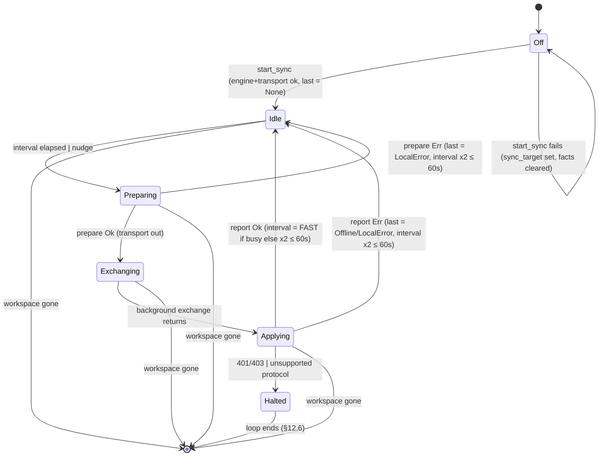

# Sync runner: the poll/exchange round

## Status

Made explicit: the round is now one `SyncPhase` (`crates/utopia-ui/src/sync_runner.rs:129`),
so where the transport is and which half of the round is running are the same fact, and
`begin_round` (`:214`) is the only way to take the transport out of `Idle`. `SyncRunner`
also owns its loop (`loop_task`, `:189`) and carries a `generation` (`:185`) that every loop
step checks, so a runner cannot have two loops and a stale loop cannot write into its
replacement.

Fixed from the list below:

| # | Issue | Fix |
|---|---|---|
| 1 | Two loops driving one runner | Runner owns its loop task (replacing the runner cancels the old loop) plus a generation check per step (`workspace.rs:485-590`) |
| 2 | A local store error reads as "Offline" | `SyncStatus::LocalError` (`crates/utopia-sync/src/lib.rs:144`), mapped in `from_result` (`:155`), rendered in `status_text` |
| 3 | No backoff after a prepare failure | `SyncRunner::round_failed` (`sync_runner.rs:234`) doubles the interval like a failed exchange |
| 4 | `status` stale during a round | `status_line` (`sync_runner.rs:336`) reads the phase, like the dot |
| 6 | Realtime 401 terminal, HTTP not | `SyncPhase::Halted` (`:140`) on 401/403 and a protocol mismatch: the loop ends (§12.6). Both halves are now terminal, as the PRD asks |
| 7 | Prepared-`None` path skips the sleep reset | Unreachable: a non-`Idle` phase never holds the transport, so `begin_round` has nothing to return `None` for unless a round is running (which one loop cannot do) |

Not fixed: **5** (`sync_target` vs `SyncFacts`). The two values answer different questions
— "what was configured" versus "did sync start" — and the divergence is deliberate and
tested (`a_sync_that_cannot_start_does_not_claim_to_be_on`): a transport that cannot be
built leaves Settings saying sync is off while the sidebar still names the target the user
asked for. Collapsing them would either promise a sync that never started or forget the
target that failed. Note that **6** is fixed in the PRD's direction (halt), not by restarting
the realtime listener; a halted runner can only be revived by starting sync again, and the
app has no in-app re-auth yet, so today that means relaunching. The realtime thread's own
restart story belongs to `realtime-listener.md`.

Uncertain item resolved: `gpui::Task` wraps `async_task::Task`, whose `Drop` cancels the
future, so dropping the runner (and its `loop_task`) does stop the old loop even when that
loop is parked in an `await`. The generation check is the second guard for a loop that is
already past its await when the new runner arrives.

Checked by eye as well as by tests: the sidebar sync view mid-round
(`docs/verification/sync-runner-round/sync-round-in-flight.png`, "Sync: syncing…" with the
amber dot), after the round (`sync-round-done.png`), and after a 401
(`sync-halted-needs-auth.png`, "● Sync: sign-in required" with the red dot).

## What it controls

The desktop background sync (`§12.3`, `§13.3`): when a round starts, which half runs on
which thread, what the sidebar dot and status line say, how fast the next poll comes, and
the "Merged changes…" banner. One `SyncRunner` lives in `Workspace.sync` and is driven by
a single `cx.spawn` loop in `Workspace::enable_sync_with`.

## Where the state lives

| Piece | Location | Type / meaning |
|---|---|---|
| Runner exists at all | `crates/utopia-ui/src/workspace.rs:194` `sync: Option<SyncRunner>` | `None` = sync off |
| Round phase, and where the transport is | `crates/utopia-ui/src/sync_runner.rs:129` `phase: SyncPhase` | `Idle { transport }` = home between rounds; `Preparing` / `Exchanging` / `Applying` = the transport is with the UI thread, the background thread, the UI thread; `Halted { reason }` = the transport is gone |
| Last round's outcome | `sync_runner.rs:176` `last: Option<SyncStatus>` | `None` = no round finished yet ("connecting…"); survives every phase |
| Poll cadence | `sync_runner.rs:178` `interval: Duration` | `FAST` 5 s … `SLOW` 60 s |
| Merge banner | `sync_runner.rs:180` `notice: Option<(String, i64)>` | shown for 5 s after `at` (`workspace.rs:2713-2716`) |
| Wake-up from realtime | `sync_runner.rs:182` `nudge: Arc<AtomicBool>` | set by the WebSocket thread (`sync_runner.rs:113`), consumed in the wait loop (`workspace.rs:505-514`) |
| Loop identity | `sync_runner.rs:185` `generation: u64` | a loop only drives the runner it was started for |
| Loop task | `sync_runner.rs:189` `loop_task: Option<Task<()>>` | replaced (cancelled), never accumulated |
| Sidebar label | `workspace.rs:409` `sync_target: Option<String>` | set even when the transport cannot be built (see issue 5) |
| Settings → Sync facts | `sync_runner.rs:36` `SyncFacts` global | set in `start_sync` (`workspace.rs:444`) |

The derived "dot" and the status line are computed, not stored: `sync_dot()` at
`sync_runner.rs:316` and `status_line()` at `:336` both match on `phase` (and read `last`
only when `Idle`/`Halted`).

## States (effective)

| State | `phase` | transport |
|---|---|---|
| Off | `sync = None` | – |
| Connecting (never completed a round) | `Idle`, `last = None` | home |
| Waiting (idle between polls) | `Idle`, `last = Some(Synced)` | home |
| Backing off | `Idle`, `last = Some(Offline/LocalError)` | home |
| Preparing (UI thread, short) | `Preparing` | with the loop |
| Exchanging (background thread) | `Exchanging` | with the background task |
| Applying (UI thread) | `Applying` | with the loop |
| Halted (401/403, protocol mismatch) | `Halted` | dropped |

## Events and transitions

- **start** `start_sync` → `enable_sync` → `enable_sync_with` (`workspace.rs:402-590`).
  Guards: engine builds, transport builds. On failure the runner is not created but
  `sync_target` **is** set (`:409`) and `SyncFacts.target` is cleared (`:451-459`).
  Installing the runner drops the previous one, and with it the previous loop task.
- **tick / nudge** The loop sleeps in 250 ms steps until `interval` elapses or
  `nudge.swap(false)` returns true (`workspace.rs:491-514`). A generation mismatch or a
  `Halted` phase ends the loop there.
- **prepare** `runner.begin_round()?` (`workspace.rs:519`, `sync_runner.rs:214`) moves
  `Idle → Preparing` and hands out the transport; `engine.prepare` (`workspace.rs:523`, which calls
  `store.sync_index()` at `crates/utopia-sync/src/lib.rs:287`) then runs.
  - prepare `Ok` → `runner.exchange()`: `Preparing → Exchanging` (`:241`).
  - prepare `Err` → `runner.round_failed(transport, status)` (`:234`): transport home,
    `last = from_result(Err)`, `interval` doubled (capped at `SLOW`).
- **exchange** `exchange_owned` on the background executor (`workspace.rs:544-547`); this is
  the only time `Exchanging` holds.
- **apply** `runner.exchange_returned()` (`:246`, `Exchanging → Applying`), `engine.apply`
  (`workspace.rs:557`); imported pages raise `app.changed(.., structural=true)`; banner set if anything
  imported; `runner.end_round(transport, &report, status)` (`:252`): `Applying → Idle` with
  `interval = FAST` if the round was busy else doubled (`sync_runner.rs:272`), or
  `Applying → Halted` when the report is `Unauthorized`/`ProtocolVersion`
  (`sync_runner.rs:258-264`).
- **quit / runner removed** Any `this.update` error breaks the loop (`workspace.rs:502`, `539`,
  `582`), as does a runner that is no longer this loop's generation.

## Impossible or unhandled combinations (evidence)

1. ~~**Two loops driving one runner.**~~ Fixed. The runner owns its loop task, so
   `enable_sync_with` cancels the previous loop; every step also checks `generation`
   (`workspace.rs:494,518,551`). Test: `enabling_sync_twice_keeps_one_poll_loop`
   (`crates/utopia-ui/tests/workspace.rs`).
2. ~~**A local store error reads as "Offline".**~~ Fixed: `SyncError::Store` maps to
   `SyncStatus::LocalError` (`crates/utopia-sync/src/lib.rs:155`) and the line says
   "● Sync: local error — …" rather than blaming the relay. Test:
   `a_local_store_error_is_not_reported_as_offline`.
3. ~~**Backoff is not applied on prepare failure.**~~ Fixed in `round_failed`
   (`sync_runner.rs:234`). Test: `a_failed_round_backs_off`.
4. ~~**`status` goes stale during a round.**~~ Fixed: the line and the dot both read the
   phase, so a round in flight says "Sync: syncing…". Test:
   `sync_runner::tests::the_status_line_follows_the_round_phase`.
5. **`sync_target` vs `SyncFacts` disagree when the transport cannot be built** — left as
   is on purpose; see Status.
6. ~~**Realtime `Unauthorized` is terminal, HTTP `NeedsAuth` is not.**~~ Fixed by making
   both terminal: `SyncPhase::Halted` stops the poll loop (§12.6), so it no longer
   "recovers" while notices stay dead. Test: `unauthorized_halts_the_poll_loop`. The
   realtime thread's own reconnect/restart behaviour is `realtime-listener.md`.
7. ~~**Prepared-`None` path skips the sleep reset.**~~ Impossible now: only `Idle` holds the
   transport and one loop owns it, so there is no `None` to prepare with. Test:
   `sync_runner::tests::one_round_at_a_time`.

## Diagram



## The state type

```rust
enum SyncPhase {
    Idle { transport: BoxTransport },   // home; `interval` and `last` are runner fields
    Preparing,                          // UI thread holds the transport
    Exchanging,                         // background thread holds it
    Applying,                           // UI thread holds it again
    Halted { reason: HaltReason },      // NeedsAuth / Unsupported: no more rounds
}
```

Two deviations from the sketch this doc first proposed, both because the code reads better
that way: `interval` and `last` stay `SyncRunner` fields (they are cadence and history, not a
phase, and both survive every transition), and the non-`Idle` phases do not store the
transport — between `begin_round` and `end_round` it is a local in the loop, which is exactly
what the two-thread handoff does. `Halted` carries a `HaltReason` rather than a `SyncError`
because only the terminal reasons exist there and that is all the dot and the line need.
