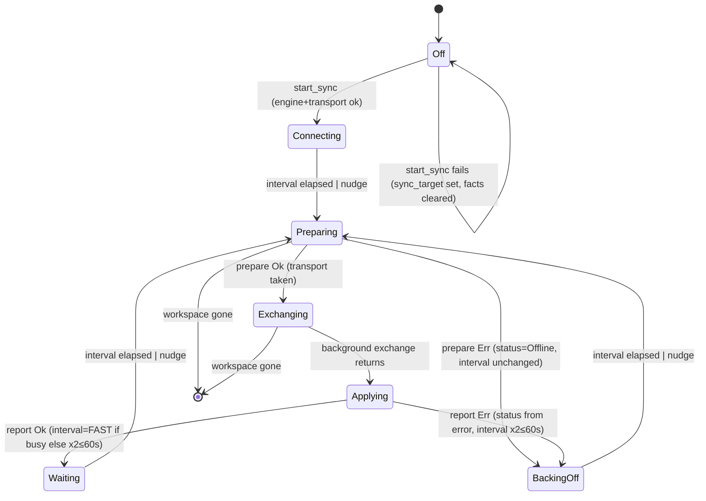

# Sync runner: the poll/exchange round

## What it controls

The desktop background sync (`§12.3`, `§13.3`): when a round starts, which half runs on
which thread, what the sidebar dot and status line say, how fast the next poll comes, and
the "Merged changes…" banner. One `SyncRunner` lives in `Workspace.sync` and is driven by
a single `cx.spawn` loop in `Workspace::enable_sync_with`.

## Where the state lives

| Piece | Location | Type / meaning |
|---|---|---|
| Runner exists at all | `crates/utopia-ui/src/workspace.rs:194` `sync: Option<SyncRunner>` | `None` = sync off |
| Transport checked out | `crates/utopia-ui/src/sync_runner.rs:128` `transport: Option<BoxTransport>` | `None` **means** "an exchange is in flight on the background thread" (comment at :127) |
| Last round's outcome | `sync_runner.rs:129` `status: Option<SyncStatus>` | `None` = no round finished yet ("connecting…") |
| Poll cadence | `sync_runner.rs:130` `interval: Duration` | `FAST` 5 s … `SLOW` 60 s |
| Merge banner | `sync_runner.rs:132` `notice: Option<(String, i64)>` | shown for 5 s after `at` (`workspace.rs:2694-2699`) |
| Wake-up from realtime | `sync_runner.rs:134` `nudge: Arc<AtomicBool>` | set by the WebSocket thread (`sync_runner.rs:113`), consumed in the wait loop (`workspace.rs:499`) |
| Sidebar label | `workspace.rs:409` `sync_target: Option<String>` | set even when the transport cannot be built |
| Settings → Sync facts | `sync_runner.rs:36` `SyncFacts` global | set in `start_sync` (`workspace.rs:451`) |
| Loop task | `workspace.rs:486` pushed into `self._tasks` | never cancelled individually |

The derived "dot" is computed, not stored: `sync_dot()` at `sync_runner.rs:190-205` reads
`transport.is_none()` first, then `status`.

## States (effective)

| State | `sync` | `transport` | `status` |
|---|---|---|---|
| Off | `None` | – | – |
| Connecting (never completed a round) | `Some` | `Some` | `None` |
| Waiting (idle between polls) | `Some` | `Some` | `Some(Synced)` |
| Backing off | `Some` | `Some` | `Some(Offline/NeedsAuth/Unsupported)` |
| Preparing (UI thread, short) | `Some` | `Some` → taken | any |
| Exchanging (background thread) | `Some` | `None` | any (stale) |
| Applying (UI thread) | `Some` | `Some` again | any (stale, then replaced) |

## Events and transitions

- **start** `start_sync` → `enable_sync` → `enable_sync_with` (`workspace.rs:444-574`).
  Guards: engine builds (`:471-480`), transport builds (`:416-437`). On failure the runner is
  not created but `sync_target` **is** set (`:409`) and `SyncFacts.target` is cleared
  (`:451-459`).
- **tick / nudge** The loop sleeps in 250 ms steps until `interval` elapses or `nudge.swap(false)`
  returns true (`:494-502`).
- **prepare** `runner.transport.take()?` (`:507`) then `engine.prepare` (`:511`, which calls
  `store.sync_index()` at `crates/utopia-sync/src/lib.rs:279`). Guard: `transport` was `Some`;
  otherwise `?` yields `None` and the loop `continue`s (`:525-527`) without sleeping again
  (it goes straight to the top and sleeps `interval`).
  - prepare `Err` → transport put back, `status = from_result(Err)` (`:515-519`). **`interval`
    is not touched** here.
- **exchange** `exchange_owned` on the background executor (`:529-532`); this is the only
  time `transport == None`.
- **apply** (`:534-567`) transport returned (`:537`), `engine.apply` (`:540`); imported pages
  raise `app.changed(.., structural=true)` (`:543`); banner set if anything imported
  (`:550-560`); `interval = next_interval(&report)` (`:561`): `FAST` if the round was not
  quiet, else `min(interval*2, SLOW)` (`sync_runner.rs:150-155`); `status = from_result`
  (`:562`).
- **quit / runner removed** Any `this.update` error breaks the loop (`:490-492`, `:524`,
  `:568-570`).

## Impossible or unhandled combinations (evidence)

1. **Two loops driving one runner.** `enable_sync_with` unconditionally does
   `self.sync = Some(runner)` (`workspace.rs:485`) and pushes a *new* loop task (`:486`)
   without stopping the previous one (tasks live in `_tasks`, which is only dropped with the
   workspace). If it is called twice, the old loop's step 3 does `runner.transport =
   Some(transport)` (`:537`) on the **new** runner, overwriting the new transport with the old
   one, and both loops then poll. Today every production caller (`crates/utopia-app/src/main.rs:371,401,407`)
   runs once per start, and `start_sync` with `lan` discovery runs only after discovery, so
   this is latent, not live. Tests call `enable_sync_with` on fresh workspaces.
2. **A local store error reads as "Offline".** `SyncStatus::from_result` maps every error
   other than `Unauthorized`/`ProtocolVersion` to `Offline { queued }`
   (`crates/utopia-sync/src/lib.rs:150-152`). A prepare failure (e.g. `sync_index()` returning a
   writer error, `lib.rs:279`) therefore shows "● Offline — N changes queued"
   (`sync_runner.rs:222-224`) although the network was never tried.
3. **Backoff is not applied on prepare failure.** Path at `workspace.rs:514-521` sets `status`
   but not `interval`; a persistent local failure keeps polling every 5 s if the last good
   round was busy.
4. **`status` goes stale during a round.** `sync_dot` handles this by checking `transport`
   first (`sync_runner.rs:194-197`, test at `:285-288`), but `status_line` (`:208-228`) does
   not: during a long exchange the text still says "Synced 2m ago" while the dot is amber.
   Cosmetic; noted because the two renderings read different fields.
5. **`sync_target` vs `SyncFacts` disagree when the transport cannot be built**: the sidebar
   names the target (`workspace.rs:409`) while Settings → Sync says sync is off (`:451-459`).
   Intentional per the comment at `:407-408`, but it is two sources of truth for "is sync on".
6. **Realtime `Unauthorized` is terminal, HTTP `NeedsAuth` is not.** `spawn_realtime` returns
   from its thread on `Unauthorized` (`sync_runner.rs:116-118`) and nothing restarts it; the
   poll loop keeps retrying at `SLOW`. If the token later becomes valid (relay-side change),
   polling recovers but realtime notices never come back. See `realtime-listener.md`.
7. **Prepared-`None` path skips the sleep reset.** When `transport` is `None` at prepare
   time (only possible with (1)), the `continue` at `:526` re-enters the wait loop, so this is
   harmless on its own.

Uncertain: whether `cx.spawn` tasks are dropped when `Workspace` is dropped before quit
(gpui semantics); the loop's `this.update` guards make a leaked task exit on the next tick.

## Diagram



## Would an explicit state type help?

Yes. `transport: Option<_>` doing double duty as "in flight" is the main smell; a
`RoundPhase` enum would make the dot, the status line and the loop read one field, and would
make "a second `enable_sync_with`" a visible transition instead of a silent overwrite.

```rust
enum SyncPhase {
    Idle { transport: BoxTransport, last: Option<SyncStatus>, interval: Duration },
    Preparing { transport: BoxTransport },
    Exchanging { since: Instant },          // transport owned by the background task
    Applying { transport: BoxTransport, result: Result<Incoming, SyncError> },
    Halted { why: SyncError },              // NeedsAuth / Unsupported: no more polling
}

struct SyncRunner {
    engine: SyncEngine,
    phase: SyncPhase,
    notice: Option<(String, i64)>,
    nudge: Arc<AtomicBool>,
    loop_task: Option<Task<()>>,            // replaced, not accumulated, on restart
}
```

`sync_dot` becomes a `match` on `phase`; `Halted` captures §12.6's "401/403: halt sync"
which today is only approximated by a 60 s backoff.
