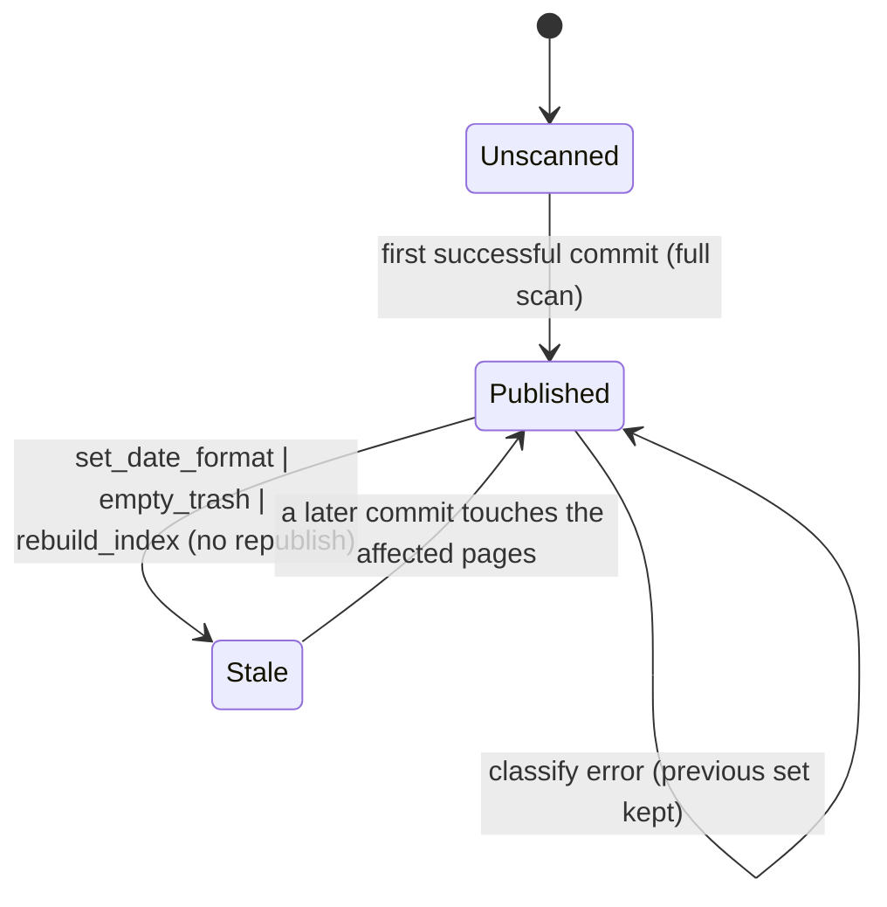

# Tag-page classification: `None` = never scanned, published per commit

## What it controls

The sidebar's set of pages that exist only because of a `#tag` (SB-2). The writer thread
publishes the set with each commit so the UI never runs the whole-graph query (rule 10).

## Where the state lives

| Piece | Location | Set | Cleared |
|---|---|---|---|
| Published set | `crates/utopia-store/src/writer.rs:118` `Shared.tag_pages: Mutex<Option<HashSet<PageId>>>` | first successful commit does a full scan (`:142-150`); later commits update written pages + changed destinations (`:151-174`) | left untouched on classify error (`:168-171`) |
| UI copy | `crates/utopia-ui/src/app_state.rs:44` `tag_pages: HashSet<PageId>` | seeded by `hashtag_only_pages()` at `:61`; replaced on `index_updated` only if `store.tag_pages()` is `Some` (`:138-140`) | – |
| Instrumentation | `writer.rs:121-127` counters; `lib.rs:128-131` | tests | – |

## States

**Unscanned** (`None`) → **Published** (`Some`) → **Published'** per job → **Stale** (see
below). The UI never sees `Unscanned`: it seeds itself with a direct query.

## Events and transitions

- first `write_job` success → full scan (`writer.rs:251-253` / `:278-279`).
- later jobs → per-page classification of `written ∪ changed_refs` (`:151-174`).
- `IndexUpdated` → UI takes the published copy (`app_state.rs:138-140`).

## Impossible or unhandled combinations (evidence)

1. **Writes that bypass `write_job` never republish.** `set_date_format` re-resolves every
   `ref.dst_page_id` on the read connection (`lib.rs:451-461`), `empty_trash` deletes
   `page`/`block` rows (`pages.rs:553-559`), `rebuild_index` reprojects everything
   (`doctor.rs:100-119`). None touch `Shared.tag_pages`, so the published set can contain
   hard-deleted pages or miss pages whose classification flipped on re-resolution until a
   later commit happens to touch them. The UI reads the set as truth.
2. **Two sources of truth at startup.** `Store::hashtag_only_pages` (`query.rs:563-568`)
   computes directly and does not feed the slot (documented at `lib.rs:232-235`), so until
   the first commit the UI copy and the (absent) published set come from different code.
3. **Failure leaves the previous set in place** (`writer.rs:135-136, :168-171`) and, when the
   commit itself failed, `publish_tag_pages` is skipped (`:251-253`); nothing tells the UI
   the set is behind (see `store-commit-pipeline.md` item 2).

## Diagram

## Would an explicit state type help?

Marginal. The useful change is procedural: route `set_date_format`, `empty_trash` and
`rebuild_index` through a "republish" hook, or stamp the set with the index version
(`Published { at_version: u64, set }`) so the UI can tell it is behind.
