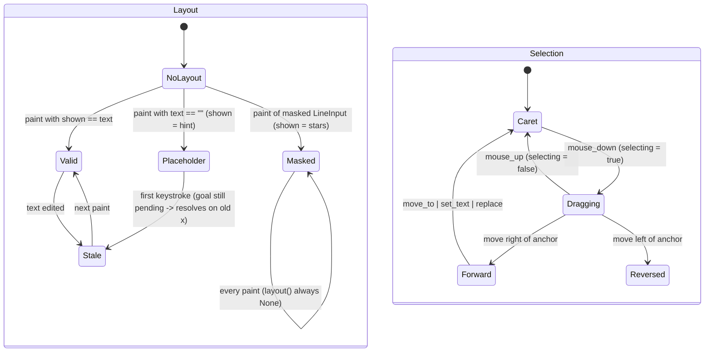

# Text field: selection/drag, layout validity, pending caret goal, masked mode

## What it controls

Inside `TextField` (`crates/utopia-ui/src/field.rs`) and its two hosts (`editor.rs`,
`line_input.rs`): the caret/selection and mouse drag, whether pixel↔byte queries can be
trusted, deferred caret placement after Up/Down between blocks, and the masked (password)
rendering of `LineInput`. Four small machines that share one struct.

## Where the state lives

| Piece | Location | Notes |
|---|---|---|
| Selection | `field.rs:28-29` `sel: Range<usize>`, `reversed: bool` | invariant `start <= end` kept by `select_to :69-80`; `reversed` reset at `set_text :51`, `move_to :66`, `replace :93`; forced false at `editor.rs:1141`, `field.rs:380` |
| Drag in progress | `field.rs:32` `selecting: bool` | true at `editor.rs:1276`, `line_input.rs:260`; false at `editor.rs:1291`, `line_input.rs:273`; never reset by `set_text`/`begin`/`end` |
| Shaped layout | `field.rs:34-36` `layout: Option<TextLayout>`, `layout_text: String`, `bounds: Option<Bounds>` | written only in `paint :554-558` |
| Validity | derived: `layout()` `:152-157` returns `None` unless `layout_text == text`; `prepaint :473 real = shown == f.text` | encoded by string equality |
| Pending caret goal | `field.rs:33` `goal: Option<Goal>` | set at `editor.rs:312` (`begin`), cleared in `resolve_goal :234` only if `has_layout() :231` |
| What was shaped | `FieldElement.shown` `:414` | the text, the placeholder (`editor.rs:1364-1375`, `line_input.rs:280-291`) or `*` stars (`line_input.rs:292-295`) |
| Masked | `line_input.rs:30` `masked: bool`, set `:65-68` | also read by `copy`/`cut` `:195, :203` |

`selection()` is read at `page_view.rs:1634` (paste outline); `has_layout`, `on_first_line`,
`on_last_line`, `point_for` are `pub` (`field.rs:159-217`) but no external callers were found.

## States

Selection: **Caret** (empty) / **Forward** / **Reversed** / **Dragging** (× any).
Layout: **None** / **Valid** / **Stale** (text changed since paint) / **Placeholder**
(`text == ""`, `layout_text == hint`) / **Masked** (`layout_text == stars`). Goal: pending or not.

## Events and transitions

- mouse down → `selecting = true`, `move_to`/word select (`editor.rs:1267-1276`); mouse move
  while `selecting` → `select_to` (`:1285`); mouse up / up-out → `selecting = false`.
- Up/Down from another block → `begin` with a `Goal::FirstLine/LastLine(x)`; next `paint`
  calls `resolve_goal` (`field.rs:559-563`) which `move_to(index_at(x))` if the layout is valid.
- Any text change → layout becomes Stale until the next paint.

## Impossible or unhandled combinations (evidence)

1. **Stale `goal` fires on the first keystroke into an empty block.** `begin` sets `goal`
   (`editor.rs:312`). For an empty block, `shown` is the hint, so `layout_text = hint != ""`,
   `has_layout()` is false, `resolve_goal` returns at `:231-233` and `goal` stays `Some`. Type
   `a`: `replace` sets `sel = 1..1`; on the next paint `layout_text == "a" == text`, so
   `resolve_goal :227-241` runs the *old* goal and `move_to(index_at(x))`, which lands at 0
   (before the `a`) when `x` is small. `paint :559-563` has no "text changed since goal was
   set" check and nothing else clears `goal`.
2. **Masked `LineInput` never has a valid layout.** `line_input.rs:293` says one `*` per byte
   keeps offsets aligned, but `layout_text = stars != text`, so `layout()` returns `None`:
   `index_at` returns `text.len()` (`field.rs:172-175`, every click puts the caret at the
   end), `bounds_for_range` returns `None` (IME candidate window mispositioned), `prepaint`
   sees `real == false` so the selection is not painted (`:482`) and the caret is drawn at
   index 0 (`:474-480, :510-511`).
3. **`vertical()` (`:188-200`) and `caret_x()` (`:182-185`) return `None` for any non-valid
   layout**, which `BlockEditor::vertical :1082-1091` reads as "at first/last line → leave
   the block". Correct for an empty block by coincidence; for a stale layout it would exit a
   multi-line block early. Uncertain whether an action can run between edit and paint.
4. **`reversed` can be true with an empty range** (drag back to the anchor: `select_to
   :76-79` only flips when `end < start`). `cursor() :55-61` still answers correctly, so
   harmless.
5. **`selecting` survives `begin()`/`set_text`.** If the row is re-targeted while the mouse
   is held, the next mouse move extends a selection in the new block. `on_mouse_up_out`
   (`editor.rs:1452`) covers most cases; uncertain whether reachable.
6. **Word-drag is unrepresentable.** Double-click selects a word and sets `selecting`, so the
   drag then extends char-by-char from the word's end rather than by word (`:1267-1285`).
7. **`select_*` handlers never call `moved()`**, so the CRDT `anchor` and the autocomplete
   are stale after a shift-selection (see `block-editor-autocomplete.md` item 2).

## Diagram



## Would an explicit state type help?

Yes for layout and goal; the selection pair is fine.

```rust
enum Shaped {
    None,
    Text { layout: TextLayout, for_text_version: u64, bounds: Bounds<Pixels> },
    Placeholder { layout: TextLayout, bounds: Bounds<Pixels> },
    Masked { layout: TextLayout, bytes_per_glyph: Vec<usize>, bounds: Bounds<Pixels> },
}
struct Goal { kind: GoalKind, x: Pixels, text_version: u64 }   // dropped if version moved
```

A `text_version: u64` bumped by every mutation replaces the string-equality test, lets
`resolve_goal` discard a goal set for different text, and lets the masked variant answer
`index_at`/`bounds_for_range` with a real byte mapping.
