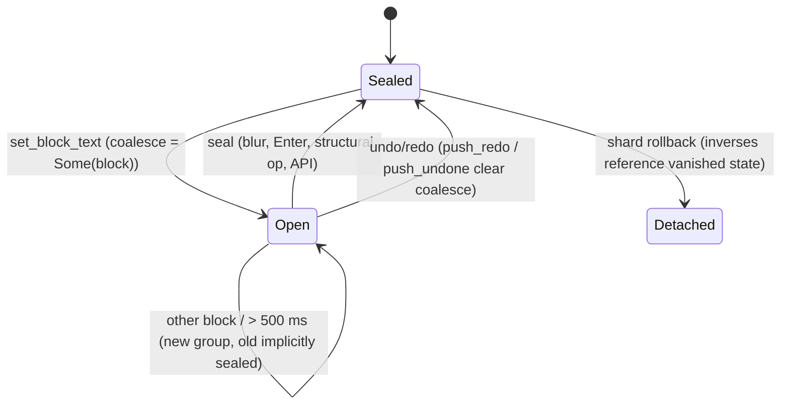

# Undo group: open for coalescing vs sealed

## What it controls

Whether consecutive keystrokes in one block merge into one undo step (FR-2.12: same block,
within 500 ms) and what Cmd+Z applies. `crates/utopia-core/src/undo.rs` and
`crates/utopia-store/src/lib.rs`.

## Where the state lives

| Piece | Location | Set | Cleared |
|---|---|---|---|
| Group open | `undo.rs:34` `UndoGroup.coalesce: Option<BlockId>`; `:35` `at_ms` | `execute_multi` copies `opts.coalesce` (`lib.rs:650`); only `set_block_text` passes `Some` (`lib.rs:752`) | `seal :95-99`; `push_redo :106`; `push_undone :116` |
| Stacks | `undo.rs:64-67` `undo`, `redo` | `push :75-92` (clears redo at `:79`) | – |
| Seal triggers | UI blur `editor.rs:591`; API `utopia-api/src/lib.rs:289, 324`; every structural store op (`pages.rs:348, 358, 461, 463, 475, 484`; `extras.rs:135, 145, 246, 256, …`) | | |

## States

**Open** (top group has `coalesce = Some(block)`; the next text edit of the same block
within `COALESCE_MS` merges, `undo.rs:80-86`) / **Sealed** (`None`).

## Events and transitions

- text edit → `push(group)`; merges if the top is open for the same block and within 500 ms,
  else pushes a new group.
- blur / Enter / structural op → `seal`.
- undo (`lib.rs:776-797`): pop, apply inverses with `if let Ok(d)`, queue, push to redo.

## Impossible or unhandled combinations (evidence)

1. **A group is popped before anything fallible runs.** `undo()` pops at `lib.rs:776`; if
   `load_doc` (`:782`) or `queue` (`:793`) errors, the group is gone from both stacks after
   some inverses were applied in memory (`:787-789`). Same shape in `redo` (`:801, :807,
   :816`). History loss, not character loss.
2. **Stack survives shard rollback.** After `flush`'s submit error (`lib.rs:322-324`) or
   `sync_index`'s `docs.clear()` (`:336`), stored inverses were computed against states that
   no longer exist; they are applied with `if let Ok(d)` (`:787, :810`) and silently skipped,
   so Cmd+Z can become a no-op or apply a subset. This is the user-visible symptom of
   `store-commit-pipeline.md` item 1.
3. **Edit applied but not undoable.** `execute_multi` queues before `undo.push` (`:683-691`);
   if `queue`/`flush` fails (Thread mode: only when the writer thread is gone,
   `writer.rs:289-296`) the edit is in memory but not on the stack. Edge.
4. **Frozen clock coalesces forever.** With `set_clock(Some(..))` (`lib.rs:385-387`),
   `at_ms` never advances so every same-block edit merges (`undo.rs:81`). Tests only.

## Diagram

## Would an explicit state type help?

Small. The open/sealed flag is fine; the risk is in `undo()`'s ordering. Peek-apply-pop
(`last()` → apply all inverses → `pop()` only on success) plus a `generation: u64` on the
store that the stack records, with groups from an older generation discarded on rollback,
would cover (1) and (2).
