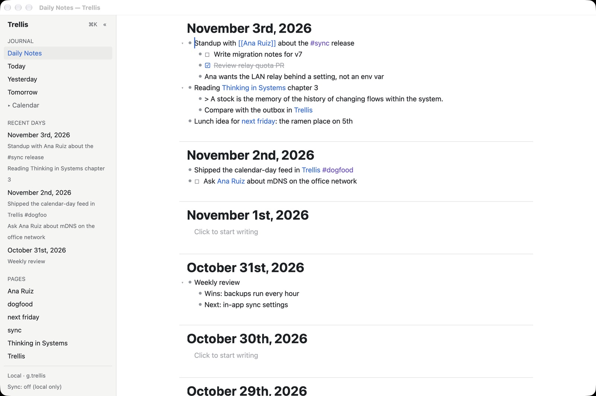
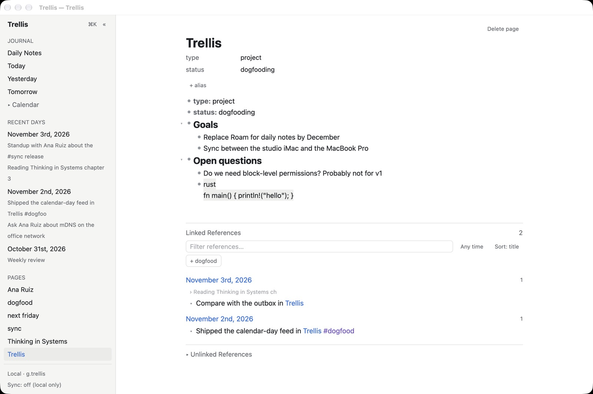
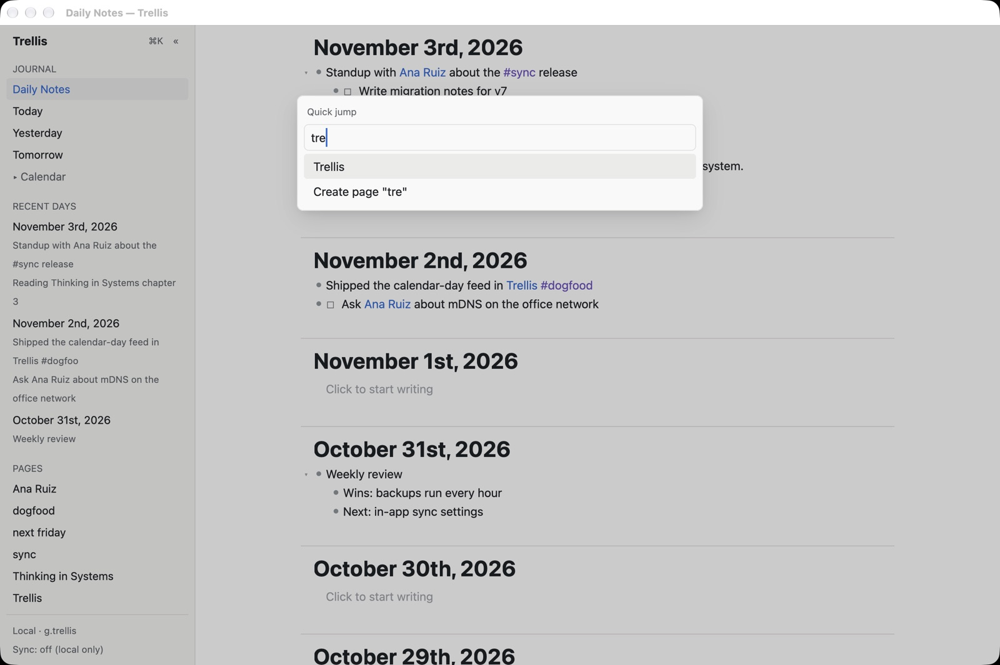
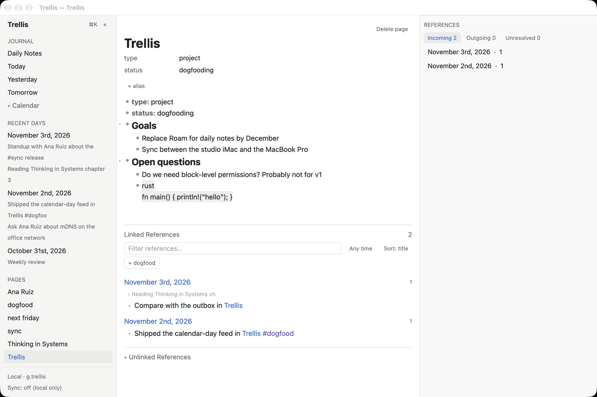
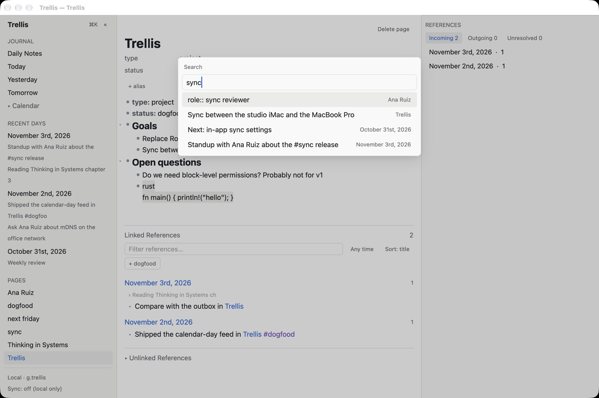
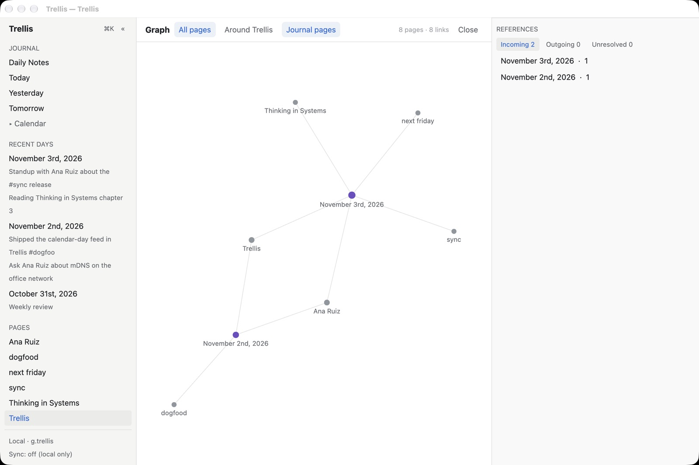

# Unslop audit: Utopia desktop UI

- **Date:** 2026-11-03, against commit `fb891bf`.
- **Skill:** [unslop](https://github.com/heydamir/unslop) by Damir Sokolovsky ([@heydamir](https://x.com/heydamir)), CC BY 4.0. It is installed in [.claude/skills/unslop](../.claude/skills/unslop/SKILL.md).
- **Method:**
  - I imported a realistic Roam export into a scratch graph: three journal days, a project page, a person, a book, to-dos, a quote, code and attributes.
  - I captured six screens from the real window with `UTOPIA_SHOT_SCRIPT` at 1280×852 in the light theme.
  - I went through every group in the skill's [signs list](../.claude/skills/unslop/references/signs.md) and checked each finding in the code.
  - The dark theme was checked only in the code (contrast ratios below), not on screen.

Nothing has been changed yet. The skill says to agree on the direction before editing.

| Daily Notes feed | Page with references |
|---|---|
|  |  |
| **Quick jump (Cmd+K)** | **Right sidebar** |
|  |  |
| **Search (Cmd+Shift+F)** | **Graph (Cmd+Shift+G)** |
|  |  |

## Verdict: light slop, so polish mode

None of the usual AI tells are here: no gradients, glows, emoji or looping animations. Nothing gets a badge, every surface is neutral, and there is a single shadow on each popover. The chrome is already quiet, and the content (the day's notes) carries the screen.

What remains is craft debt:

- headings and labels are too heavy;
- the sidebar section labels are uppercase;
- links use two hues;
- the light theme's `faint` text fails contrast;
- a few places truncate text badly or show raw markup.

The skill's rule for this case is to fix only what the audit found, keep the palette, type and layout, and treat bigger ideas as suggestions. That is what this document does.

## Proposed direction

- **Product.** A local-first outliner for one person who thinks in writing on a Mac: each day's notes and the pages they link to form one graph.
- **Character.** Patient, exact, a little warm.
- **World.** A paper notebook with an index of cards: ink on off-white, ruled margins, a library catalogue.
- **Moments.**
  - The day title at the top of each day in the feed, because the feed is the product.
  - The Linked References block, which is where the graph appears to the user.
  - Both get the most typographic care. The chrome around them stays quiet.
- **Signature.** The bullet as an ink dot.
  - A collapsed block with hidden children gets a soft ring around its dot, as in Roam.
  - The same dot appears in the graph's nodes.
  - Use it nowhere else.

## Audit

Each line gives the sign, where it lives and the fix. Line numbers are as of `fb891bf`.

### Type

1. **Bold (700) headings everywhere.**
   - Where:
     - day titles in the feed: [page_view.rs:2352](../crates/utopia-ui/src/page_view.rs:2352);
     - page titles: [page_view.rs:1892](../crates/utopia-ui/src/page_view.rs:1892);
     - H1–H3 blocks: [page_view.rs:1709](../crates/utopia-ui/src/page_view.rs:1709);
     - the "Utopia" wordmark: [workspace.rs:1085](../crates/utopia-ui/src/workspace.rs:1085);
     - the "Graph" title: [graph_view.rs:269](../crates/utopia-ui/src/graph_view.rs:269);
     - the PDF title: [pdf_view.rs:419](../crates/utopia-ui/src/pdf_view.rs:419);
     - attribute keys: [rich.rs:212](../crates/utopia-ui/src/rich.rs:212).
   - Fix:
     - Titles become `FontWeight::MEDIUM` (500) at 28 px. Hierarchy comes from size and colour.
     - H1–H3 become `SEMIBOLD` (600) at most.
     - Attribute keys become 400 in the `muted` colour; the colour alone sets them apart.
     - The wordmark becomes 500.
2. **Uppercase section labels.**
   - Where: "JOURNAL", "RECENT DAYS" and "PAGES" ([workspace.rs:1121](../crates/utopia-ui/src/workspace.rs:1121), [1182](../crates/utopia-ui/src/workspace.rs:1182), [1205](../crates/utopia-ui/src/workspace.rs:1205)) and "REFERENCES" ([workspace.rs:1453](../crates/utopia-ui/src/workspace.rs:1453)).
   - Fix: sentence case ("Journal", "Recent days", "Pages", "References"), 12 px, 500, `muted`, 24 px above and 8 px below.
3. **Calendar marks days that have notes with bold.**
   - Where: [calendar.rs:91](../crates/utopia-ui/src/calendar.rs:91).
   - Fix: keep the weight at 400 and put a 4 px dot in `muted` under the number. Weight shifts make the grid jitter.
4. **Inline code is in the proportional font.**
   - Where: inline code only gets a background ([rich.rs:113–117](../crates/utopia-ui/src/rich.rs:113)). Code blocks use Menlo ([page_view.rs:1717](../crates/utopia-ui/src/page_view.rs:1717)). The page screenshot shows `fn main() { println!("hello"); }` in the text face.
   - Fix: set the same mono family on inline code. One shared `MONO` constant in `theme.rs` serves both.
5. **Italic quotes.**
   - Where: [page_view.rs:1715](../crates/utopia-ui/src/page_view.rs:1715).
   - Fix: keep the left rule and the `muted` colour, and drop `.italic()`. The rule already says "quote".
6. **Counts are not tabular.**
   - Where: reference counts ("2", "1"), "8 pages · 8 links" and the right sidebar's "Incoming 2".
   - Fix: tabular figures via `FontFeatures` `tnum` on count text, so columns of counts line up.

### Color

7. **Two link hues.**
   - Where: page links use `accent` blue (#2f6fdb), while tags use `tag` purple (#7a52c7) ([theme.rs:45](../crates/utopia-ui/src/theme.rs:45), [rich.rs:126](../crates/utopia-ui/src/rich.rs:126)). Journal nodes in the graph are purple too.
   - Why it matters: blue plus purple is the family the skill flags. FR-2.15 also says hashtags *are* page links, yet they render as a different kind of thing.
   - Fix: one accent. Draw tags in the accent, or in `muted` with the accent on hover. Graph journal nodes become the accent or a darker ramp step.
8. **`faint` is used for text and fails contrast.**
   - The ratios: 2.28:1 on white (#a8acb1) and 3.33:1 in dark.
   - Where it carries readable text:
     - "Click to start writing" ([page_view.rs:2332](../crates/utopia-ui/src/page_view.rs:2332), [2381](../crates/utopia-ui/src/page_view.rs:2381));
     - "Loading older days…" ([page_view.rs:2399](../crates/utopia-ui/src/page_view.rs:2399));
     - reference breadcrumbs ([page_view.rs:2490](../crates/utopia-ui/src/page_view.rs:2490));
     - done to-dos ([page_view.rs:1722](../crates/utopia-ui/src/page_view.rs:1722));
     - graph stats ([graph_view.rs:288](../crates/utopia-ui/src/graph_view.rs:288));
     - PDF meta ([pdf_view.rs:422](../crates/utopia-ui/src/pdf_view.rs:422)).
   - Fix: text uses `muted` (4.99:1). `faint` stays for bullets, rules and the collapse chevrons only. Done to-dos can stay `muted` with the strike-through.
9. **Selected nav item: accent on the hover surface is 4.09:1.**
   - Where: "Daily Notes" and "Utopia" in the sidebar. Chip text on `chip_bg` is 4.23:1.
   - Fix: selected rows use primary `text` on the `hover` surface with a 2 px accent bar on the left, or a darker accent shade for selected text (#2a62c4 reaches 5.3:1 on #eeeeec).
10. **Colours outside the theme.**
    - Where:
      - warning amber `0xd97706` ([workspace.rs:1252](../crates/utopia-ui/src/workspace.rs:1252));
      - the modal scrim at 18% black ([workspace.rs:1597](../crates/utopia-ui/src/workspace.rs:1597));
      - the PDF highlight and selection `hsla` ([pdf_view.rs:329](../crates/utopia-ui/src/pdf_view.rs:329), [372](../crates/utopia-ui/src/pdf_view.rs:372)).
    - Fix: add `warn`, `scrim` and `pdf_highlight` tokens with dark variants. The scrim is heavy for a light app; 8–10% is enough under a shadowed panel.
11. **The neutral ramp mixes temperatures.**
    - Where: the light sidebar (#f6f6f4), border (#e4e4e1) and code background (#f0f0ee) are warm, but the text (#1f2328) and muted (#6b7076) are cool blue-grey.
    - Fix: pick one temperature. The warm ramp fits the paper world: text #1f1b16, secondary #5e554a, muted #7b7266, sidebar #f7f4ee. The page background stays white so notes read as paper on a desk.
12. **The theme's doc comment promises a high-contrast palette ([theme.rs:1](../crates/utopia-ui/src/theme.rs:1), §15.4), but none exists.** Either add one or fix the comment.

### Icons

13. **Text glyphs stand in for icons.**
    - Where:
      - ▸/▾ chevrons ([page_view.rs:1597](../crates/utopia-ui/src/page_view.rs:1597), [2543](../crates/utopia-ui/src/page_view.rs:2543));
      - ☐/☑ to-dos ([page_view.rs:1687](../crates/utopia-ui/src/page_view.rs:1687));
      - « for collapse, › for next day and breadcrumbs.
    - The problems: they render at the font's whim in size, weight and baseline. The collapse chevrons are ~8 px and faint, so they are hard to hit, and the to-do box sits on a different baseline from its text.
    - Fix: one SVG line set through GPUI's `svg()` (lucide: `chevron-right`, `chevron-down`, `square`, `square-check`, `panel-left-close`), 16 px, stroke 1.5, `muted` colour, a fixed 16 px box so text aligns.

### Spacing and layout

14. **Recent-day rows are tall and gappy.**
    - Where: the previews are 12 px text but inherit the 24 px editor line height ([workspace.rs:1188–1200](../crates/utopia-ui/src/workspace.rs:1188)), so each preview line takes ~37 px in the screenshot. The gap inside a day is the same as the gap between days.
    - Fix: line height 16 px for previews, 2 px between the title and its previews, 12 px between days.
15. **Truncation without an ellipsis, cut mid-word.**
    - Where:
      - sidebar previews use `chars().take(48)` ("Utopia #dogfoo"): [workspace.rs:1200](../crates/utopia-ui/src/workspace.rs:1200);
      - reference breadcrumbs ("Reading Thinking in Systems ch"): [page_view.rs:2475–2491](../crates/utopia-ui/src/page_view.rs:2475).
    - Fix: one line each, cut at a word boundary with "…", or let the layout clip with an ellipsis.
16. **Blank days cost ~180 px each in the feed.**
    - What happens: header padding, the placeholder, bottom padding and a divider. A blank week fills a screen with nothing.
    - Fix: blank days keep the title but drop to `pt 16 / pb 8` and no extra spacer, so they read as a quieter rhythm between written days. Roam does the same.
17. **"+ alias" sits 12 px right of the attribute column** in the page header.
    - Fix: align it to the title's left edge.
18. **Attributes appear twice on a page.**
    - What happens: "type / status" shows in the metadata header and again as `type:: project` blocks right under it.
    - Fix: keep the header, and render attribute blocks quieter (`muted`, 13 px) or collapse them under the header by default.
    - This is a product call (the blocks are the source of truth, §10), so it is a suggestion only.
19. **The graph view's filter toggle reads as a second selected tab.**
    - What happens: "Journal pages" uses the same filled pill as the selected "All pages", so it looks like two tabs are selected.
    - Fix: segmented control for All/Around; the journal toggle becomes a checkbox-style control with its own label.
20. **Radii are under the 4 px floor.**
    - Where: `rounded_sm()` (2 px) is used 15 times, on chips, filter pills and inputs.
    - Fix: chips and tags 4–6, inputs and rows 6–8, popovers 10–12, with nested radius: the quick-jump panel at 12 with 8 px padding holds rows at 4–6.

### Copy

21. **Placeholders end in "…".**
    - Where: "Filter references…", "Go to page or date…", "Search all blocks…", "Capture to today's note…", "Title…" ([quick_jump.rs:77–80](../crates/utopia-ui/src/quick_jump.rs:77), [page_view.rs:245](../crates/utopia-ui/src/page_view.rs:245)).
    - Fix: "Filter references", "Go to page or date", "Search", "Capture to today", "Title".
    - Keep the "…" on "Redirect…", because macOS uses it for commands that open a dialog. Keep it on "Loading older days…" too.
22. **The sidebar footer says one thing twice.** "Local · g.utopia" sits over "Sync: off (local only)".
    - Fix: one line, "g.utopia · Not syncing" (or "· Synced 2 min ago").
23. **Search results show raw attribute markup**, e.g. "role:: sync reviewer".
    - Fix: run result text through the same inline renderer as blocks, so the key shows as a label.
24. **The window title doubles up** on a page named like the app ("Utopia — Utopia"), and the graph view keeps the previous page's title.
    - Fix: "Graph — Utopia" for the graph view. Accept the double on a page literally named Utopia, or drop the suffix when the names match.
25. **"Linked References" / "Unlinked References" are title case.**
    - Fix: "Linked references", "Unlinked references", to match sentence case elsewhere.

### Motion

No findings. The only motion is the instant hover colour change on day titles and nav rows, which is what the skill asks for. When animation is added later, use one curve (`cubic-bezier(0.22, 1, 0.36, 1)`), 120–180 ms for hover and press, and 160–220 ms for popovers.

### Seen while auditing (not design, but visible)

- **Roam quotes stay literal.** A Roam block starting with `> ` imports as literal "> text" instead of a quote block.
- **Code fences keep their language tag.** A fenced block (```` ```rust ````) imports as text with "rust" on its own first line, instead of a code block.
- **Where:** both are in `import-roam`; see [a-feed.jpg](unslop-audit/a-feed.jpg) and [c-page.jpg](unslop-audit/c-page.jpg).

## Suggested order of work

Each item is small and independent; together they are about a day's work.

1. Type weights and sentence case (findings 1–3, 5, 25). This is the biggest visible change for the least code.
2. Contrast: `faint` → `muted` for text, and the selected nav item (8, 9).
3. One link hue (7).
4. Sidebar rhythm and truncation (14, 15).
5. Mono inline code and tabular counts (4, 6).
6. SVG icon set (13).
7. Theme tokens for stray colours, the warm ramp, and radii (10, 11, 20).
8. Copy pass (21–24).
9. Layout suggestions that need a product call (16–19, 12).

For each step, check the result with a `UTOPIA_SHOT_SCRIPT` capture of the same six screens and compare it with the images above, as AGENTS.md requires for visible changes.

## Checklist status (from the skill)

- [ ] The direction is written and every pass follows it (proposed above, not agreed yet)
- [x] Every spacing value is on the 4px scale (GPUI's `p_1`… steps are 4 px; the `px()` values are layout sizes)
- [ ] Icons, labels and numbers each sit in one aligned column (glyph icons drift; findings 6, 13)
- [ ] One neutral ramp, three text roles, one accent with enough contrast (findings 7–9, 11)
- [x] No hue gradients, gradient text, glows, coloured shadows or blobs
- [x] No emoji in the interface
- [ ] One icon set at one size and stroke (finding 13)
- [ ] Weights 400–600, no uppercase tracked labels, no italic (findings 1–3, 5)
- [ ] No trailing ellipsis on short strings, no greeting headline (finding 21; the rest pass)
- [ ] Numbers in one format with tabular figures (finding 6)
- [ ] Nested radii add up (finding 20)
- [x] No looping or bouncy motion
- [ ] Template check: swapping in another notes app's name would still fit, so the signature detail (the ink-dot bullet and collapsed ring) and the warm ramp are what would make it Utopia

---

The audit method and checklist come from unslop by Damir Sokolovsky ([@heydamir](https://x.com/heydamir)), CC BY 4.0.
