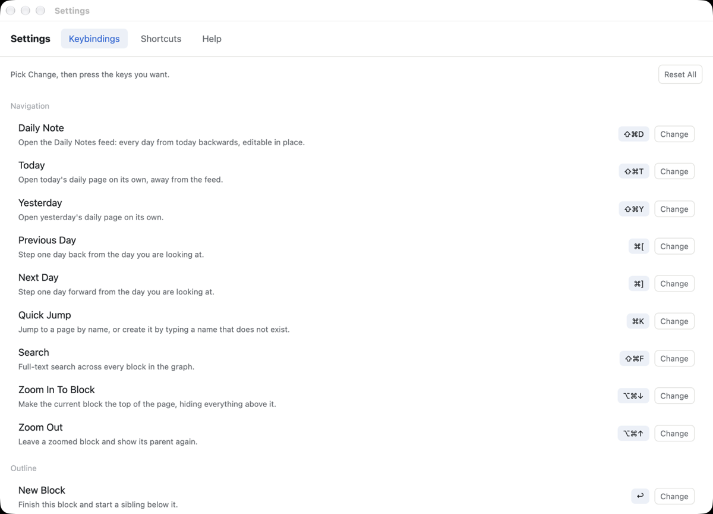
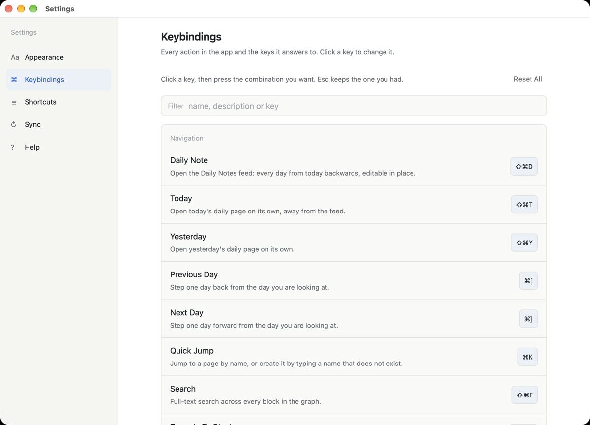

# Settings (⌘,) — verification captures

Branch `redesign/08-settings`, ideas ST-1 to ST-5 from `docs/redesign-ideas.md`.

Every capture is the app photographing its own window (`UTOPIA_SHOT_SCRIPT`), against a
scratch graph seeded with `xtask`'s `seed_help_graph` (the Demo graph: Atlas Launch, Ana
Lovelace, Reading, a few days of notes) under `target/redesign-08/`. `UTOPIA_CONFIG_DIR` and
`--graph` both point into that folder, so the user's own notes and config were never touched.
Windows are the real 1100×760 Settings window; the PNGs here are downscaled to 1200 px wide.

| Before | After |
|---|---|
|  |  |

`settings-before.png` is the capture in `docs/images/settings-keybindings.png` (the old UI):
tabs across the top, rows running the whole window width, a key chip and a "Change" button
at the far right, no filter. The after shot shows ST-1 (720 px column of cards, hairline
between rows), ST-4 (the filter above the cards) and ST-5 (the tab list at the left with an
icon per tab).

- **ST-1 / ST-5 — the readable column and the side tabs.** `settings-keybindings.png`: one
  card per category, 720 px wide, centred in the pane beside the 220 px tab rail.
- **ST-4 — search actions.** `settings-search.png`: typing "zoom" in the filter leaves the
  two Zoom actions and the line above says `2 of 58 shortcuts match "zoom"`. It matches
  names, help text and the keys in force (the test covers all three, plus escape to clear).
- **ST-2 — the chip is the control.** `settings-capture.png`: after clicking Today's key
  chip, the chip reads "Press keys…" and is the only control on the row. There is no
  "Change" button anywhere. `settings-clash.png` also shows the small ↺ on the changed row,
  left of the chip.
- **ST-3 — clashes inline.** `settings-clash.png`: the config's `keymap.json` puts Today on
  ⇧⌘Y, which Yesterday already uses. Each of the two rows carries an amber line, "Also used
  by Yesterday" / "Also used by Today", with the other action underlined and clickable; the
  link scrolls the list to that row and highlights it for a moment (asserted by
  `a_clash_link_scrolls_to_the_other_card`).
- **ST-5 — the Sync tab.** `settings-sync.png`: this scratch graph syncs nowhere, so the
  pane says sync is off, names the graph id, and explains that the transport (relay or
  shared folder) and its secrets come from the environment and the keychain at launch. No
  token or passphrase is shown (`sync_facts_never_carry_secrets`).
- **ST-5 — Help without a second sidebar.** `settings-help.png`: the topics are chips under
  the pane title, the prose is one 720 px column and the 640 px screenshots fit instead of
  being clipped by an inner nav.
- **Density still works.** `settings-compact.png`: the same Keybindings pane with
  `settings.json` at `"density": "compact"` — 13.5 px body, 7 px row padding, more actions
  per screen — and `settings-appearance.png` shows the Appearance pane (font and density
  cards) at Comfortable.

Reproduce with:

```bash
cargo run -p xtask -- help-shots   # seeds target/help-shots/Demo.utopia, then captures Help
cp target/help-shots/Demo.utopia target/redesign-08/Demo.utopia
UTOPIA_CONFIG_DIR=$PWD/target/redesign-08/config \
UTOPIA_SHOT_SCRIPT="wait 900; keys escape; wait 300; keys cmd-,; wait 1400; target last; wait 700; shot target/redesign-08/shots/keybindings.png; click 660 165; type zoom; wait 600; shot target/redesign-08/shots/search.png; keys escape; click 982 349; wait 600; shot target/redesign-08/shots/capture.png" \
  cargo run -p utopia-app -- --graph target/redesign-08/Demo.utopia
```

`help-shots` rewrites `crates/utopia-ui/assets/help/*.png` on the way; revert those files
(`git checkout -- crates/utopia-ui/assets/help`) unless you mean to refresh them. It also
runs `target/debug/utopia` by path, so with a shared `CARGO_TARGET_DIR` it seeds the graph and
then fails to launch: put your target directory first on the path and run the `utopia` binary
from there with the script above. The clash capture used a second config directory whose
`keymap.json` binds `GoToday` to `cmd-shift-y`.
